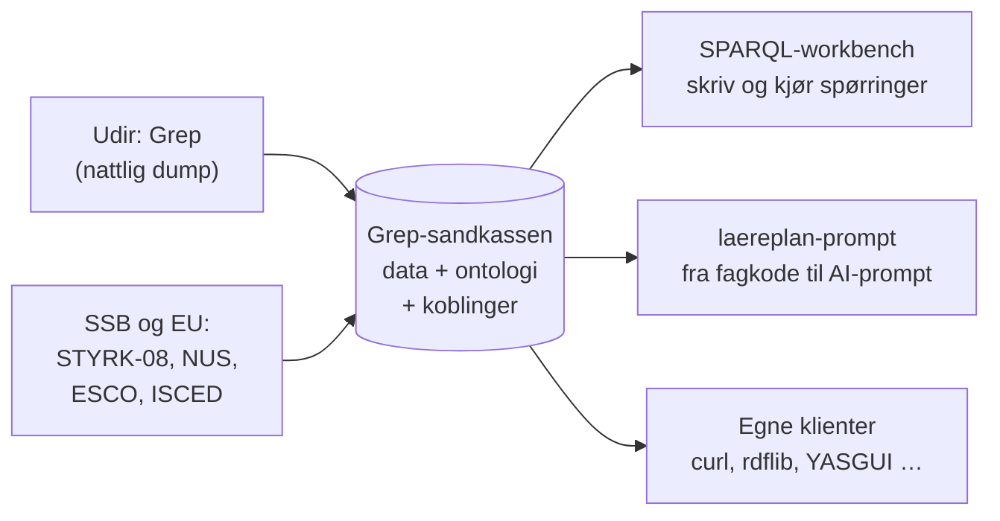
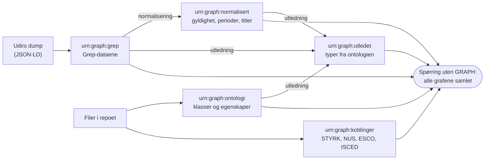
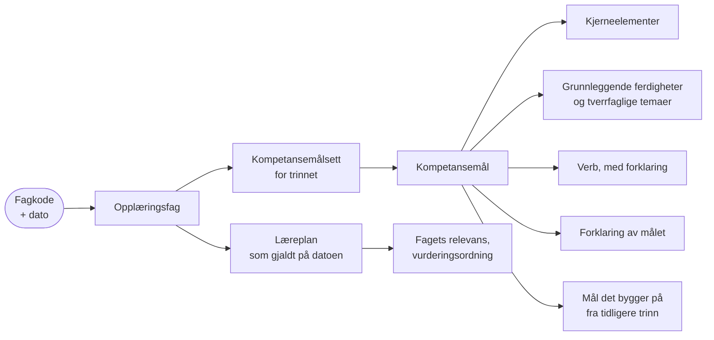

# Grep-data som kunnskapsgraf: SPARQL-sandkasse

Dette er et åpent SPARQL-endepunkt med Grep-dataene (læreplaner, kompetansemål, fag, fagkoder m.m.) fra
Utdanningsdirektoratet, med en ontologi lagt ved. Det er en **eksperimentell sandkasse**, ikke en offisiell
Udir-tjeneste.

> **Til produksjonsbruk** bruker du Udirs offisielle endepunkt `https://sparql-data.udir.no/repositories/201906`
> eller REST-API-et på `https://data.udir.no/kl06/v201906/`. Sandkassen kan endres, være nede eller forsvinne 
> uten varsel.



## Denne dokumentasjonen

Dokumentasjonen ligger i repoene den hører til, og sidene lenker til hverandre:

| Side | Innhold |
|---|---|
| **Brukerveiledning** (denne siden) | Hvordan du spør mot sandkassen: dataene, ontologien, de normaliserte dataene, koblingene og eksempler |
| [Drift og oppsett](../README.md) | Hvordan sandkassen er satt opp: Fuseki på Fly.io, nattlig innlasting, grafer, feilsøking |
| [laereplan-prompt](https://github.com/aremjolsnes/laereplan-prompt) | **Anvendelse:** fra fagkode til AI-prompt. Henter læreplanutsnittet fra sandkassen og setter det sammen med vurderingsdata. Med [demomanus](https://github.com/aremjolsnes/laereplan-prompt/blob/main/docs/demomanus.md), [øving](https://github.com/aremjolsnes/laereplan-prompt/blob/main/docs/oeving.md) og [kostnadsoverslag](https://github.com/aremjolsnes/laereplan-prompt/blob/main/docs/kostnad.md) |

Samlet, med meny, kan sidene leses i
[SPARQL-workbenchen](https://sparql.mjolne.com/dokumentasjon?endepunkt=Sandkassen).

## Kom i gang

| | |
|---|---|
| **SPARQL-endepunkt** | `https://grep-fuseki-v3.fly.dev/ds/query` |
| **Nettgrensesnitt** | [grep-fuseki-v3.fly.dev/#/dataset/ds/query](https://grep-fuseki-v3.fly.dev/#/dataset/ds/query) |
| **Tilgang** | Åpent for lesing. Ingen innlogging. |
| **Oppdatering** | Hver natt fra Udirs JSON-LD-dump, omtrent kl. 02:30 (03:30 sommertid). Bare når det er endringer. |

Første spørring etter en periode uten bruk kan ta 5–10 sekunder, fordi tjenesten starter opp ved behov.
Spørringene etterpå går raskt.

Fra kommandolinjen:

```bash
curl -H "Accept: application/sparql-results+json" \
     --data-urlencode "query=SELECT * WHERE { ?s ?p ?o } LIMIT 5" \
     https://grep-fuseki-v3.fly.dev/ds/query
```

Endepunktet følger SPARQL 1.1-protokollen, så alle SPARQL-klienter fungerer, for eksempel rdflib, Apache Jena,
SPARQLWrapper og YASGUI. Bruk `Accept: text/csv` hvis du vil ha CSV.

## Prefikser

```sparql
PREFIX u:    <http://psi.udir.no/ontologi/kl06/>   # egenskaper og typer i Grep
PREFIX d:    <http://psi.udir.no/kl06/>            # Grep-ressurser (læreplaner, kompetansemål, ...)
PREFIX udir: <http://psi.udir.no/ontologi/>        # begreper sandkassen foreslår for Udir, se «Normaliserte data»
PREFIX st:   <https://data.udir.no/kl06/v201906/status/status_>   # statusverdier, se «Egenheter»
PREFIX rdf:  <http://www.w3.org/1999/02/22-rdf-syntax-ns#>
PREFIX rdfs: <http://www.w3.org/2000/01/rdf-schema#>
PREFIX owl:  <http://www.w3.org/2002/07/owl#>
PREFIX xsd:  <http://www.w3.org/2001/XMLSchema#>
PREFIX text: <http://jena.apache.org/text#>        # fritekstsøk, se «Fritekstsøk»
PREFIX skos: <http://www.w3.org/2004/02/skos/core#>
PREFIX styrk: <http://psi.udir.no/ontologi/styrk08/>  # yrkesgrupper i STYRK-08 fra SSB, se «Koblinger»
PREFIX isco: <http://data.europa.eu/esco/isco/>     # ISCO-08-grupper i ESCO
PREFIX nus: <http://psi.udir.no/ontologi/nus/>      # utdanninger i NUS (SSB), se «Koblinger»
PREFIX iscedf: <http://data.europa.eu/esco/isced-f/>  # fagfelt i ISCED-F 2013 (ESCO)
PREFIX isced2011: <http://psi.udir.no/ontologi/isced2011/>  # nivå i ISCED 2011
PREFIX esco: <http://data.europa.eu/esco/model#>   # ESCO-modellen (yrker og ferdigheter)
PREFIX sssom: <https://w3id.org/sssom/>             # koblinger mellom vokabularer (SSSOM (uttales "sessom"))
PREFIX semapv: <https://w3id.org/semapv/vocab/>     # begrunnelser for koblinger (SSSOM)
PREFIX dcterms: <http://purl.org/dc/terms/>
PREFIX dcat: <http://www.w3.org/ns/dcat#>          # beskrivelse av datasettet, se «Hvor ferske er dataene?»
PREFIX void: <http://rdfs.org/ns/void#>
```

Eksemplene under forutsetter disse prefiksene.

## Hvordan dataene er organisert

Dataene ligger i seks navngitte grafer. **Spørringer uten `GRAPH` ser alle samlet**, så de fleste spørringer
trenger ikke å bry seg om grafene.

| Graf | Innhold |
|---|---|
| `urn:graph:grep` | Grep-dataene fra Udir (omtrent 1,2 millioner tripler). Datoer og tall har riktige datatyper, ellers uendret. |
| `urn:graph:ontologi` | Ontologien: klasser, egenskaper og koblinger til typene i dataene |
| `urn:graph:normalisert` | Gyldighet som egne ressurser, perioder som datoer og tittel per målform (omtrent 330 000 tripler) |
| `urn:graph:utledet` | Typene fra ontologien, utledet fra typene i dataene (omtrent 50 000 tripler) |
| `urn:graph:koblinger` | Koblinger til andre kunnskapsgrafer: yrker i STYRK-08 (videre til ESCO) og utdanninger i NUS (videre til ISCED) (se «Koblinger til andre kunnskapsgrafer») |
| `urn:graph:meta` | Når dataene sist ble oppdatert |

Slik blir grafene til hver natt:



Vil du ha *bare* Grep-dataene, for eksempel for å sammenligne med Udirs offisielle endepunkt, pakker du
spørringen inn i `GRAPH <urn:graph:grep> { … }`. Det gjelder særlig spørringer som teller eller lister *alt*
(alle tripler, alle typer, alle egenskaper). Uten `GRAPH` er ontologien og de normaliserte og utledede dataene
også med i tallene. For eksempel får hver ressurs to typer, `u:kompetansemaal` og `u:Kompetansemaal`.

**Hvor ferske er dataene?**

```sparql
SELECT ?endretHosUdir ?lastet ?endringsId WHERE {
  GRAPH <urn:graph:meta> {
    ?m <https://grep.udir.no/schema/lastet> ?lastet ;
       <https://grep.udir.no/schema/last-id> ?endringsId .
    OPTIONAL { ?m <https://grep.udir.no/schema/endret-hos-udir> ?endretHosUdir }
  }
}
```

- `endretHosUdir` er tidspunktet for siste endring hos Udir (`tidspunkt` i
  [endringsloggen](https://data.udir.no/kl06/v201906/endringer)), i norsk tid. Det mangler hvis
  endringsloggen var tom da dataene ble lastet.
- `lastet` er når sandkassen ble oppdatert (UTC). Den nattlige jobben kjører ca. 02:30 norsk tid, så
  `lastet` ligger normalt noen timer etter `endretHosUdir`, og noen ganger mer hvis en kjøring feilet.
- `endringsId` er id-en til den nyeste endringen i endringsloggen *da sandkassen ble lastet*. Åpne
  endringsloggen og sammenlign med `endrings-id` i det øverste innslaget, som er den nyeste endringen
  *nå*. Er de like, har sandkassen alle Udirs endringer. Begynner `endringsId` med `sha256:`, var
  endringsloggen tom ved innlastingen, og da kan du ikke sammenligne på denne måten.

**Beskrivelse av datasettet (DCAT og VoID).** Metagrafen beskriver også sandkassen som datasett etter DCAT-AP-NO
(som på data.norge.no) og VoID: tittel, beskrivelse, utgiver, lisens (NLOD 2.0), kilde (Udirs Grep-API),
SPARQL-endepunkt, vokabularer, når den sist ble oppdatert (`dcterms:modified`) og antall tripler per graf:

```sparql
SELECT ?graf ?tripler WHERE {
  GRAPH <urn:graph:meta> {
    ?ds a dcat:Dataset ; void:subset ?del .
    ?del dcterms:title ?graf ; void:triples ?tripler .
  }
} ORDER BY DESC(?tripler)
```

Hele beskrivelsen får du med `DESCRIBE ?ds WHERE { GRAPH <urn:graph:meta> { ?ds a dcat:Dataset } }`. Sandkassen
er et privat eksperiment, så utgiveren er Are Mjølsnes, ikke Udir. Udir er oppgitt som kilde.

## Eksempler

**Hvilke typer finnes, og hvor mange av hver?**

```sparql
SELECT ?type (COUNT(?s) AS ?antall) WHERE {
  GRAPH <urn:graph:grep> { ?s a ?type }
} GROUP BY ?type ORDER BY DESC(?antall)
```

De største er `u:kompetansemaal` (LK06, omtrent 17 000), `u:kompetansemaal_lk20` (omtrent 15 000) og `u:fagkode`.

**Kompetansemålene i en læreplan** (her LK20-læreplanen i norsk, NOR01-07):

```sparql
SELECT ?kode ?tittel WHERE {
  ?km a u:kompetansemaal_lk20 ;
      u:tilhoerer-laereplan d:NOR01-07 ;
      u:kode ?kode ;
      u:tittel ?tittel .
  FILTER(LANG(?tittel) = "default")
} ORDER BY ?kode
```

Titler finnes på flere språk: `default`, `nob`, `nno`, `eng`, `sme`, `sma` og `smj`.
`default` er fastsettelsesspråket.

**Hvilken læreplan erstatter hvilken?**

```sparql
SELECT ?kode ?erstatter ?erstattesAv WHERE {
  ?lp u:kode ?kode .
  FILTER(?kode IN ("NOR1-05", "NOR01-06"))
  OPTIONAL { ?lp u:erstatter ?erstatter }
  OPTIONAL { ?lp u:erstattes-av ?erstattesAv }
}
```

Kjeden går på tvers av revisjonene: NOR1-04 → NOR1-05 (LK06) → NOR01-06 (LK20) → NOR01-07. «Erstatter» er en
faglig vurdering. Når en plan splittes i flere, eller bare en liten del av innholdet videreføres, finnes det
ikke nødvendigvis en erstatter-kobling.

## Ontologien

Grep-dataene i seg selv har typer og egenskaper, men ingen ontologi som beskriver dem. Sandkassen har en
Grep-ontologi (OWL) med 44 klasser, for eksempel `u:Laereplan`, `u:Laereplan_lk20`, `u:Kompetansemaal` og
`u:Kompetansemaal_lk20`, med norske og engelske navn og beskrivelser.

Klassene i ontologien skrives med **stor forbokstav**. Typene i dataene skrives med **liten**
(`u:kompetansemaal`). Grunnen er at mange av navnene med liten forbokstav også brukes som egenskaper. For
eksempel er `u:kompetansemaalsett` både en type og en egenskap. Ontologien kobler hver klasse til typen i
dataene med `owl:equivalentClass` og `rdfs:subClassOf`.

**Hvilke klasser finnes?**

```sparql
SELECT ?klasse ?navn ?beskrivelse WHERE {
  GRAPH <urn:graph:ontologi> {
    ?klasse a owl:Class ; rdfs:label ?navn .
    FILTER(isIRI(?klasse) && LANG(?navn) = "nb")
    OPTIONAL { ?klasse rdfs:comment ?beskrivelse FILTER(LANG(?beskrivelse) = "nb") }
  }
} ORDER BY ?klasse
```

**Hvilke egenskaper har en LK20-læreplan?**

```sparql
SELECT ?egenskap ?navn WHERE {
  GRAPH <urn:graph:ontologi> {
    ?egenskap rdfs:domain ?d .
    { FILTER(?d = u:Laereplan_lk20) }
    UNION
    { ?d owl:unionOf/rdf:rest*/rdf:first u:Laereplan_lk20 }
    OPTIONAL { ?egenskap rdfs:label ?navn FILTER(LANG(?navn) = "nb") }
  }
} ORDER BY ?egenskap
```

Domene og rekkevidde i ontologien er justert etter hvordan dataene faktisk ser ut. Generelle egenskaper som
`u:tittel`, `u:kode` og `u:status` brukes på nesten alle typer og har derfor ikke noe domene.

**Overbegreper på tvers av revisjonene.** Læreplaner, kompetansemål og kompetansemålsett finnes i én utgave for
LK06 og én for LK20. Sandkassen har et overbegrep for hver av dem, som omfatter begge utgavene:

| Overbegrep | LK06 | LK20 |
|---|---|---|
| `udir:Laereplan` | `u:Laereplan` | `u:Laereplan_lk20` |
| `udir:Kompetansemaal` | `u:Kompetansemaal` | `u:Kompetansemaal_lk20` |
| `udir:Kompetansemaalsett` | `u:Kompetansemaalsett` | `u:Kompetansemaalsett_lk20` |

Alle læreplaner, uansett revisjon:

```sparql
SELECT ?lp ?kode WHERE {
  ?lp a udir:Laereplan ; u:kode ?kode .
} ORDER BY ?kode
```

Hovedområder (LK06) og kjerneelementer (LK20) har en lignende plass i læreplanen, men er ulike begreper. De har
derfor ikke noe felles overbegrep, og det finnes ingen kobling mellom dem. Klasser som allerede gjelder begge
revisjonene, for eksempel `u:Fagkode` og `u:Opplaeringsfag`, har heller ikke noe overbegrep.

**Reform og revisjon.** Kunnskapsløftet (`udir:KL06`) er reformen. LK06 (`udir:LK06`) og LK20, fagfornyelsen
(`udir:LK20`), er revisjonene av den. Samiske læreplanverk er varianter innenfor hver revisjon. Ressurser som
hører til én revisjon, har `udir:revisjon`:

| Revisjon | Klasser |
|---|---|
| `udir:LK06` | læreplan, kompetansemål, kompetansemålsett, hovedområde og programfag |
| `udir:LK20` | læreplan, kompetansemål, kompetansemålsett, kjerneelement, tverrfaglig tema, grunnleggende ferdighet, ordforklaring og verb |

Fagkoder, opplæringsfag, programområder og andre ressurser som gjelder begge revisjonene, har ingen revisjon.

Antall kompetansemål per revisjon:

```sparql
SELECT ?revisjon (COUNT(?km) AS ?antall) WHERE {
  ?km a udir:Kompetansemaal ; udir:revisjon ?r .
  ?r rdfs:label ?revisjon FILTER(LANG(?revisjon) = "nb")
} GROUP BY ?revisjon
```

**Begrepssystemer (SKOS).** Fagtyper, opplæringsnivåer, fagkategorier, fagområder, språk og språknivåer er
SKOS-begreper (`skos:Concept`) i fem begrepssystemer:

| Begrepssystem | Begreper |
|---|---|
| `udir:Fagtyper` | fellesfag, valgfag, felles programfag … (10) |
| `udir:Opplaeringsnivaaer` | grunnskole, videregående opplæring, forberedende opplæring for voksne (3) |
| `udir:Fagkategorier` | fagkategoriene (8), med fagområdene (51) under seg (`skos:broader`/`skos:narrower`) |
| `udir:Spraak` | språkene i Grep (10), koblet til EUs språktabell |
| `udir:Spraaknivaaer` | Nivå I, II og III i fremmedspråk (3) |

Begrepene er Grep-ressursene selv, for eksempel `d:fagtype_valgfag` og `d:FKAT100`. De har `skos:prefLabel` på
bokmål (`nb`), nynorsk (`nn`) og, der Grep har det, engelsk (`en`) og nordsamisk (`se`), og koden som
`skos:notation`. Fagtype og opplæringsnivå er egne begrepssystemer. At valgfag brukes i grunnskolen, står i
Grep-dataene som `u:opplaeringsnivaa` på fagtypen.

Fagområdene i hver fagkategori:

```sparql
PREFIX skos: <http://www.w3.org/2004/02/skos/core#>
SELECT ?kategori ?omraade WHERE {
  ?k skos:topConceptOf udir:Fagkategorier ; skos:prefLabel ?kategori ; skos:narrower ?o .
  ?o skos:prefLabel ?omraade .
  FILTER(LANG(?kategori) = "nb" && LANG(?omraade) = "nb")
} ORDER BY ?kategori ?omraade
```

**Språk og EUs språktabell.** Hvert språk i Grep har `skos:exactMatch` til samme språk i
[EUs språktabell](http://publications.europa.eu/resource/authority/language), som bruker de samme ISO 639-kodene:
`d:nob` er `<http://publications.europa.eu/resource/authority/language/NOB>`. Da kan Grep brukes sammen med
andre data som følger EU-standarden. Læreplaner som er tilgjengelige på nordsamisk:

```sparql
PREFIX skos: <http://www.w3.org/2004/02/skos/core#>
SELECT ?lp ?kode WHERE {
  ?lp u:tilgjengelige-spraak/skos:exactMatch <http://publications.europa.eu/resource/authority/language/SME> ;
      u:kode ?kode .
} ORDER BY ?kode
```

Språknivåene svarer til CEFR-nivåene A1, A2 og B1, som står som tekst i `u:cefr`. CEFR har ikke noe offisielt
vokabular med faste adresser ennå, så sandkassen kobler ikke nivåene videre.

**Dublin Core.** Relasjonene i Grep finnes også med Dublin Core-navn (`dcterms:`), slik at verktøy som kjenner
Dublin Core, forstår dem direkte:

| Grep | Dublin Core |
|---|---|
| `u:erstatter` / `u:erstattes-av` | `dcterms:replaces` / `dcterms:isReplacedBy` |
| `u:tilhoerer-laereplan` | `dcterms:isPartOf` |
| `u:fastsatt-dato` (datoen planen ble vedtatt) | `dcterms:dateAccepted` |
| `u:fastsatt-spraak` (språket planen er fastsatt på) | `dcterms:language` |

`u:tilgjengelige-spraak` har ingen Dublin Core-utgave: den omfatter alle språkene planen finnes på, også det
fastsatte. Tittel, kode, beskrivelse og sist endret har heller ingen ennå. Bruk `u:`-egenskapene for dem.

Kjeden av læreplaner som erstatter hverandre, med Dublin Core:

```sparql
PREFIX dcterms: <http://purl.org/dc/terms/>
SELECT ?fra ?til WHERE {
  ?a dcterms:isReplacedBy ?b .
  ?a u:kode ?fra . ?b u:kode ?til .
  FILTER(STRSTARTS(?fra, "NOR1"))
} ORDER BY ?fra
```

**Gyldighet og schema.org.** Alle `udir:`-egenskapene for gyldighet og perioder er beskrevet i ontologien,
med navn og forklaring på bokmål, nynorsk og engelsk. `udir:gyldigFra` og `udir:gyldigTil` finnes også som
`schema:validFrom` og `schema:validThrough`, som er det vanligste vokabularet for gyldighet på nettet.
Undervisning og eksamen har ingen schema.org-utgave, for da ville schema.org ikke skilt mellom de tre periodene.

```sparql
PREFIX schema: <https://schema.org/>
SELECT ?fra ?til WHERE { d:AGR3001 schema:validFrom ?fra ; schema:validThrough ?til }
```

**Bruke ontologien i spørringer.** Hver natt utleder sandkassen typene fra ontologien (`urn:graph:utledet`),
så klassene med stor forbokstav og overbegrepene kan brukes direkte:

```sparql
SELECT ?klasse (COUNT(?s) AS ?antall) WHERE {
  VALUES ?klasse { u:Kompetansemaal u:Kompetansemaal_lk20 }
  ?s a ?klasse
} GROUP BY ?klasse
```

Sandkassen kjører ikke en resonnerer. Utledningen er egne SPARQL-regler (`sparql/utledning/` i repoet) som
følger `rdfs:subClassOf` og `rdfs:subPropertyOf` i ontologien. Domene og rekkevidde brukes bevisst ikke til å
utlede typer. Hos Udir gir `?s a u:Kompetansemaal` ingen treff.

## Normaliserte data

Hver natt, etter innlastingen, retter sandkassen svakheter i dumpen: gyldighet som egne ressurser,
perioder som datoer, og datoer og tall med riktige datatyper. Reglene ligger som SPARQL Update i
`sparql/normalisering/` i repoet.

**Gyldighet som egne ressurser.** Hver kobling med fra–til-dato får en ressurs av typen `udir:Gyldighet` med
egenskapene `udir:relasjon`, `udir:objekt`, `udir:gyldigFra` og `udir:gyldigTil`. Ressursen henger på subjektet
med `udir:gyldighet`. IRI-en er satt sammen av subjekt, relasjon og objekt, for eksempel
`http://psi.udir.no/kl06/gyldighet/ADI2001/opplaeringsfag/ADI2Z01`, og er den samme fra natt til natt.
Datoene er `xsd:date`, og begge ender er alltid satt (se «Perioder» under om 1970-01-01 og 2100-12-31).

```sparql
SELECT ?fag ?fra ?til WHERE {
  d:ADI2001 udir:gyldighet ?g .
  ?g udir:relasjon u:opplaeringsfag ;
     udir:objekt ?fag ;
     udir:gyldigFra ?fra ;
     udir:gyldigTil ?til .
}
```

Alle koblinger som var gyldige på en bestemt dato:

```sparql
SELECT ?s ?relasjon ?objekt WHERE {
  ?s udir:gyldighet ?g .
  ?g udir:relasjon ?relasjon ; udir:objekt ?objekt ;
     udir:gyldigFra ?fra ; udir:gyldigTil ?til .
  FILTER(?fra <= "2020-08-01"^^xsd:date && ?til >= "2020-08-01"^^xsd:date)
} LIMIT 100
```

En kobling kan ha flere gyldighetsperioder. Periode nummer 2 og videre får nummeret bak IRI-en, for eksempel
`…/gyldighet/DTDGH2----/bygger-paa-programomraade/TPTIP1----/2` (gyldig fra 2023-08-01, etter at den første
perioden sluttet 2022-07-31). I dumpen heter slike egenskaper `u:gyldighet-2-…`.

**Perioder: gyldighet, undervisning og eksamen.** Grep uttrykker tid både med redaksjonelle datoer
(`u:gyldig-fra`/`u:gyldig-til`) og med semestre (`d:semester_hoest_2021`). Sandkassen gjør begge om til datoer
(`xsd:date`), slik at samme sammenligning virker overalt:

| Egenskap | Hvor | Kilde |
|---|---|---|
| `udir:gyldigFra` / `udir:gyldigTil` | fagkoder, læreplaner, merknader m.fl. | `u:gyldig-fra` / `u:gyldig-til` (satt redaksjonelt) |
| `udir:gyldigFra` / `udir:gyldigTil` | programområder, utdanningsprogram | `u:foerste-semester` / `u:siste-semester` |
| `udir:undervisningFra` / `udir:undervisningTil` | fagkoder med undervisning | `u:naar-gis-det-undervisning-…-semester` |
| `udir:eksamenFra` / `udir:eksamenTil` | fagkoder med eksamen | `u:naar-kan-man-ta-eksamen-…-semester` |
| `udir:startdato` / `udir:sluttdato` | semestre | vår 01.01–31.07, høst 01.08–31.12 |

- Fra-datoen er første og til-datoen **siste** dag i perioden. Klokkeslett i Grep-dataene er kuttet bort.
- **1970-01-01 og 2100-12-31** betyr at Grep ikke har satt noen dato i den enden («fra starten» eller
  «inntil videre»). Det er sandkassens egne verdier, ikke Udirs.
- **Undervisning og eksamen er egne perioder.** En fagkode kan ha begge, bare én av dem eller ingen. Har den ikke
  eksamen, har den ingen `udir:eksamenFra`. Spør derfor alltid: undervisning eller eksamen? Gyldighetsdatoene
  settes redaksjonelt og kan avvike litt fra semestrene.
- **Status er noe annet.** `st:publisert` betyr at posten er i bruk i Grep, ikke at den gjelder i dag. En
  fagkode er ofte publisert etter siste undervisningssemester, så lenge man kan ta eksamen.

Fagkoder det gis undervisning i i dag:

```sparql
SELECT ?fk ?fra ?til WHERE {
  BIND(xsd:date(SUBSTR(STR(NOW()), 1, 10)) AS ?idag)
  ?fk udir:undervisningFra ?fra ; udir:undervisningTil ?til .
  FILTER(?fra <= ?idag && ?til >= ?idag)
} ORDER BY ?fk
```

Bytt `undervisning` med `eksamen` eller `gyldig` for de andre periodene. `?idag` lages uten tidssone med vilje:
Grep-datoene har ingen tidssone, og en direkte sammenligning med `NOW()` kan da gi feil svar rundt midnatt.

Kunne man ta eksamen i AGR3001 våren 2026?

```sparql
SELECT ?fra ?til ?kanTaEksamen WHERE {
  d:semester_vaar_2026 udir:startdato ?start ; udir:sluttdato ?slutt .
  d:AGR3001 udir:eksamenFra ?fra ; udir:eksamenTil ?til .
  BIND(?fra <= ?slutt && ?til >= ?start AS ?kanTaEksamen)
}
```

**Tittel på bokmål og nynorsk.** `u:tittel` med språket `default` er tittelen på fastsettelsesspråket. Det kan
være nynorsk, og for 19 LK20-læreplaner nordsamisk. Det gjelder også kompetansemålene og kjerneelementene i dem.
Læreplanene og alt som hører til dem har derfor én tittel per målform, med fast rekkefølge av reserver:

| Egenskap | 1. valg | 2. valg | 3. valg |
|---|---|---|---|
| `udir:bokmaalTittel` | bokmål | nynorsk | fastsettelsesspråket |
| `udir:nynorskTittel` | nynorsk | bokmål | fastsettelsesspråket |

Verdien er merket med språket den faktisk er på (`nb`, `nn`, `se` …), så `LANG()` viser om en reserve er brukt.
Kompetansemålene i en samisk læreplan, på bokmål:

```sparql
SELECT ?kode ?tittel WHERE {
  ?km u:tilhoerer-laereplan d:DDU02-03 ; u:kode ?kode ; udir:bokmaalTittel ?tittel .
} ORDER BY ?kode
```

**Datoer og tall med riktige datatyper.** Disse egenskapene er gjort om fra tekst direkte i
`urn:graph:grep`:

| Datatype | Egenskaper |
|---|---|
| `xsd:dateTime` | `u:sist-endret`, `u:gyldig-fra`, `u:gyldig-til`, `u:fastsatt-dato`, `u:siste-eksamen` |
| `xsd:integer` | `u:aarstimer`, `u:aarstimer-doeve-og-tunghoerte`, `u:aarstimer-formgivningsfag`, `u:aarstimer-samisk`, `u:omfang-totalt`, `u:omfang-vitnemaal`, `u:omfang-til-naa` |
| `xsd:decimal` | `u:opplaeringstid`, `u:verdiskapingstid` (desimalkomma i dumpen, «1,00» blir 1.00) |

Datofunksjoner og sammenligninger virker direkte:

```sparql
SELECT ?s ?endret WHERE {
  ?s u:sist-endret ?endret .
  FILTER(?endret >= "2026-01-01T00:00:00"^^xsd:dateTime)
} ORDER BY DESC(?endret) LIMIT 20
```

**Dette fungerer annerledes enn hos Udir.** Sammenligner du med en tekststreng, for eksempel
`FILTER(?d >= "2026-01-01")`, gir det ingen treff her. Bruk en typet verdi som over, eller `STR(?d)`.

## Koblinger til andre kunnskapsgrafer

**Yrker (STYRK-08 og ESCO).** Programområdene på Vg3 som har en yrkestittel (`u:yrkestittel`), er koblet til
yrkesgruppen sin i SSBs yrkesklassifisering STYRK-08 med `udir:yrkesklassifisering`. STYRK-08 bygger på
ISCO-08, og hver gruppe har `skos:exactMatch` til samme ISCO-gruppe i ESCO, EUs klassifikasjon av yrker og
ferdigheter. Derfra finner man ESCO-yrkene og ferdighetene deres.

- **300 av 309 programområder** har en kobling, også utgåtte, slik at de som tok utdanningen tidligere er med.
  194 koblinger kommer direkte fra SSBs Yrkeskatalog. De andre er vurdert manuelt.
- Koblinger går aldri til STYRK-hovedgruppe 1 (ledere) eller 2 (akademiske yrker), som krever høyere utdanning.
- STYRK-08 ligger som begrepssystem (`udir:Styrk08`) med alle 582 gruppene på fire nivåer og `skos:broader`
  mellom dem. SSB har ingen faste URI-er for kodene, så sandkassen lager dem selv (`styrk:7231`).
- Kilden er [ontologi/koblinger/styrk.csv](https://github.com/aremjolsnes/grep-jena-fuseki/blob/main/ontologi/koblinger/styrk.csv).
  Der står det for hver kobling om den kommer fra SSB (`ssb-yrkeskatalog`) eller er vurdert manuelt.

**Hvilke yrkesgrupper utdanner bilfagene til?** (yrkestitler som begynner på «Bil»)

```sparql
SELECT ?kode ?yrke ?styrk ?gruppe ?isco WHERE {
  ?p u:yrkestittel ?yrke ; u:kode ?kode ; udir:yrkesklassifisering ?k .
  FILTER(lang(?yrke) = "default" && STRSTARTS(?yrke, "Bil"))
  ?k skos:notation ?styrk ; skos:prefLabel ?gruppe ; skos:exactMatch ?isco .
} ORDER BY ?kode
```

**Hvor mange programområder utdanner til hver hovedgruppe?**

```sparql
SELECT ?hovedgruppe ?navn (COUNT(DISTINCT ?p) AS ?antall) WHERE {
  ?p udir:yrkesklassifisering ?k .
  ?k skos:broader+ ?h .
  ?h skos:topConceptOf udir:Styrk08 ; skos:notation ?hovedgruppe ; skos:prefLabel ?navn .
} GROUP BY ?hovedgruppe ?navn ORDER BY ?hovedgruppe
```

**ESCO-yrkene.** Under ISCO-gruppene ligger ESCOs yrker. Sandkassen har med alle ESCO-yrkene under gruppene
programområdene er koblet til, også underyrkene: rundt 700 yrker, hvert med norsk navn, norsk beskrivelse
(`skos:definition`), ESCO-kode og `skos:broader` til ISCO-gruppen eller yrket over. URI-ene er ESCOs egne. ESCO har
ikke noe offentlig SPARQL-endepunkt, så yrkene hentes fra ESCO-API-et med `scripts/lag-esco-ttl.py`.

**ESCO-ferdighetene.** Ferdighetene til ESCO-yrkene er også med: rundt 6 500 ferdigheter og 26 000 koblinger fra
ESCO-versjonen som står i `ontologi/koblinger/esco-ferdigheter.ttl`. I tillegg er alle de 120 tverrgående
ferdighetene med (gjenbruksnivå *transversal*, for eksempel *løse konflikter* og *utøve rettigheter og ansvar*),
også de som ikke er knyttet til noe yrke. Språkferdighetene er ikke med.
- Koblingene går fra ferdighet til yrke, slik ESCO har dem: `esco:isEssentialSkillFor` (essensiell) og
  `esco:isOptionalSkillFor` (valgfri).
- Hver ferdighet har `skos:prefLabel`, `skos:altLabel` og `skos:definition` på norsk.
- `esco:skillType` sier om det er en ferdighet/kompetanse eller kunnskap. `esco:skillReuseLevel` sier om den er
  tverrgående, sektorovergripende, sektorspesifikk eller yrkesspesifikk.
- Ferdighetsgruppene over ferdighetene ligger i `skos:broader`. Kunnskapsferdigheter peker også til fagfelt i
  ISCED-F 2013, de samme som NUS-kodene peker til.
- Ferdighetene lastes ned fra ESCO (en fil per versjon) og hentes ut med `scripts/lag-esco-ferdigheter-ttl.py`. Den
  nattlige jobben melder et avvik når ESCO har en nyere versjon.

Koblinger mellom kompetansemål og ESCO-ferdigheter finnes foreløpig for tre læreplaner (se «Kompetansemål og
ESCO-ferdigheter» under).

> **This service uses the ESCO classification of the European Commission.** (Denne tjenesten bruker
> EU-kommisjonens ESCO-klassifikasjon.) Sandkassen har en *endret* utgave av ESCO: bare et utdrag (yrkene under
> ISCO-gruppene programområdene er koblet til, og ferdighetene deres), og språkkoden er endret fra `no` til `nb`. Koblingene fra Grep til
> ESCO er sandkassens egne og ikke en del av ESCO. EU-kommisjonen garanterer ikke at ESCO, eller oversettelsene i
> ESCO, er riktige, oppdaterte eller fullstendige. Vilkår: [ESCO, Download](https://esco.ec.europa.eu/en/use-esco/download)
> (Kommisjonens beslutning 2011/833/EU om gjenbruk).

**Hvilke ESCO-yrker utdanner Bilfaget, tunge kjøretøy til?**

```sparql
SELECT ?kode ?yrke ?beskrivelse WHERE {
  d:TPBTK3---- udir:yrkesklassifisering/skos:exactMatch ?isco .
  ?y skos:broader+ ?isco ; skos:notation ?kode ; skos:prefLabel ?yrke ; skos:definition ?beskrivelse .
} ORDER BY ?kode
```

**Hvilke ferdigheter er essensielle for en servicetekniker for bil, og hvor mange andre yrker deler dem?**

```sparql
PREFIX esco: <http://data.europa.eu/esco/model#>
SELECT ?ferdighet ?type (COUNT(DISTINCT ?annet) AS ?andreYrker) WHERE {
  ?y skos:prefLabel "servicetekniker, bil"@nb .
  ?f esco:isEssentialSkillFor ?y ; skos:prefLabel ?ferdighet ; esco:skillType/skos:prefLabel ?type .
  OPTIONAL { ?f esco:isEssentialSkillFor|esco:isOptionalSkillFor ?annet FILTER(?annet != ?y) }
} GROUP BY ?ferdighet ?type ORDER BY DESC(?andreYrker)
```

**Ferdigheter innen samme fagfelt (ISCED-F) som utdanningen til et programområde:**

```sparql
PREFIX esco: <http://data.europa.eu/esco/model#>
SELECT DISTINCT ?fagfelt ?ferdighet WHERE {
  d:TPBTK3---- udir:utdanningsklassifisering/skos:broadMatch ?iscedf .
  FILTER(STRSTARTS(STR(?iscedf), STR(iscedf:)))
  ?iscedf skos:prefLabel ?fagfelt .
  ?f a esco:Skill ; skos:broader ?iscedf ; skos:prefLabel ?ferdighet .
} ORDER BY ?ferdighet LIMIT 50
```

**Kompetansemål og ESCO-ferdigheter.** Kompetansemålene i Vg3-læreplaner er koblet til ESCO-ferdighetene til yrkene
programområdet utdanner til, og til ESCOs tverrgående ferdigheter. Det finnes ingen offisiell kobling mellom læreplaner
og ESCO. Disse koblingene er sandkassens egne og ikke en del av ESCO. En språkmodell foreslår koblingene
(`scripts/foreslaa-km-esco.py`). Alle de 223 gjeldende Vg3-læreplanene med STYRK-kobling har koblinger, til sammen
23 940, og de er av to slag:
- **Vurdert av et menneske (454):** pilotene BMK03-03 (120 koblinger), HEA03-03 (115) og ELE03-04 (106), BKF03-02
  (63) og en stikkprøve på 50.
- **Automatiske og ikke vurdert (23 486):** resten. I en prøve ble alle de 403 forslagene som et menneske vurderte,
  godtatt. Etterpå ble en tilfeldig stikkprøve på 50 automatiske koblinger, fra 50 ulike læreplaner, vurdert, og
  alle 50 var riktige. Det betyr at minst 93 % av de automatiske koblingene er riktige (95 % konfidensintervall).
  Sandkassen tar derfor med de automatiske koblingene og retter heller i etterkant.

ESCO har ingen yrker for blomsterdekoratør (ISCO 7549). BLD03-03 og BLD05-01 er derfor bare koblet til de
tverrgående ferdighetene, og de fleste av disse koblingene er `skos:relatedMatch`.

Begge slagene har direkte SKOS-tripler. Om et menneske har vurdert koblingen, står i SSSOM-noden
(`sssom:reviewer_label`; se spørringen under).

Relasjonen leses fra kompetansemålet:

| Relasjon | Betyr | Eksempel |
|---|---|---|
| `skos:closeMatch` | omtrent det samme | KM8647 (lavspenningssystemer) ↔ *reparere elektriske kjøretøysystemer* |
| `skos:narrowMatch` | ferdigheten er en del av målet | KM8640 (hjulutrustning) ↔ *balansere dekk* |
| `skos:broadMatch` | ferdigheten er bredere enn målet | KM10083 (bremser) ↔ *utføre reparasjoner av kjøretøy* |
| `skos:relatedMatch` | beslektet, men ikke en del av målet | KM8644 (drivlinjer) ↔ *hybridbilarkitektur* |

Koblingene er beskrevet med [SSSOM](https://mapping-commons.github.io/sssom/), en standard for koblinger mellom
vokabularer. Hver kobling har en egen node (`sssom:Mapping`) med begrunnelse, forfatter, kontrollør og hvilket
koblingssett den hører til. Alle koblingene finnes i tillegg som direkte SKOS-tripler. Kilden er
`ontologi/koblinger/km-esco/*.sssom.tsv`. Forslag som et menneske har avvist, ligger i `*.avvist.tsv` og lastes ikke
inn.

**Bare koblinger som et menneske har vurdert:**

```sparql
SELECT ?km ?relasjon ?ferdighet ?kontrollor WHERE {
  ?m a sssom:Mapping ; sssom:subject_id ?km ; sssom:predicate_id ?r ; sssom:object_id ?f ;
     sssom:reviewer_label ?kontrollor .
  ?f skos:prefLabel ?ferdighet .
  BIND(STRAFTER(STR(?r), "#") AS ?relasjon)
} ORDER BY ?km LIMIT 100
```

**Ferdighetene til et kompetansemål:**

```sparql
SELECT ?relasjon ?ferdighet ?type WHERE {
  d:KM8644 ?r ?f .
  ?f a esco:Skill ; skos:prefLabel ?ferdighet ; esco:skillType/skos:prefLabel ?type .
  VALUES ?r { skos:closeMatch skos:narrowMatch skos:broadMatch skos:relatedMatch }
  BIND(STRAFTER(STR(?r), "#") AS ?relasjon)
} ORDER BY ?relasjon ?ferdighet
```

**Hull 1: kompetansemål uten ESCO-ferdighet.** Hvilke mål i læreplanen fant vi ingen ESCO-ferdighet for?
For BMK03-03 er svaret tomt: etter at de tverrgående ESCO-ferdighetene kom med som kandidater, har alle
22 kompetansemålene minst én ferdighet. Bytt læreplankode for å se hullene i andre læreplaner.

```sparql
# forventer tomt
SELECT ?kode ?tekst WHERE {
  d:BMK03-03 u:kompetansemaalsett/u:kompetansemaal ?km .
  ?km u:kode ?kode ; udir:bokmaalTittel ?tekst .
  FILTER NOT EXISTS {
    ?km skos:closeMatch|skos:narrowMatch|skos:broadMatch|skos:relatedMatch ?f . ?f a esco:Skill
  }
}
```

**Hull 2: essensielle ESCO-ferdigheter uten kompetansemål.** Hvilke ferdigheter er essensielle for yrkene
programområdet utdanner til, men ikke koblet til noe kompetansemål i læreplanen?

```sparql
SELECT ?ferdighet (COUNT(DISTINCT ?y) AS ?antallYrker) WHERE {
  d:TPBMK3---- udir:yrkesklassifisering/skos:exactMatch ?isco .
  ?y skos:broader+ ?isco .
  ?f esco:isEssentialSkillFor ?y ; skos:prefLabel ?ferdighet .
  FILTER NOT EXISTS {
    d:BMK03-03 u:kompetansemaalsett/u:kompetansemaal ?km .
    ?km skos:closeMatch|skos:narrowMatch|skos:broadMatch|skos:relatedMatch ?f
  }
} GROUP BY ?ferdighet ORDER BY DESC(?antallYrker) ?ferdighet
```

Et hull betyr «ikke funnet blant kandidatene». Kandidatene er ferdighetene til ESCO-yrkene under ISCO-gruppen til
programområdet, pluss ESCOs 120 tverrgående ferdigheter (utenom språk). En ferdighet som verken hører til yrkene eller
er tverrgående, kan derfor mangle. Et eksempel er *arbeide ergonomisk* for helsearbeiderfaget, som ble lagt inn for
hånd.

**Utdanninger (NUS og ISCED).** Alle programområdene, også Vg1 og Vg2, er koblet til utdanningen sin i SSBs
utdanningsgruppering NUS med `udir:utdanningsklassifisering`. Det finnes ingen offisiell tabell fra programområde til
NUS, så koblingen er sandkassens eksperimentelle forslag. NUS-koden har `skos:broadMatch` videre til fagfeltet i ISCED-F 2013 (som ESCO
publiserer) og nivået i ISCED 2011, etter SSBs egne korrespondansetabeller. Det er klassifiseringene som brukes i
europeisk utdanningsstatistikk og i Europass.

- **491 av 497 programområder** har en kobling. 421 har samme navn og trinn som NUS-koden, for eksempel
  «Bilfaget, lette kjøretøy» på Vg3 og NUS 455204 «Bilfaget, lette kjøretøy, Vg3».
- Finnes koden både i ny og gammel ordning, får utgåtte programområder gammel ordning og publiserte ny.
- Varianter for Steinerskolen, Montessori og Den tyske skole har samme kode som den vanlige utgaven av
  programområdet.
- 21 koblinger der navnet ikke stemte, er vurdert av et menneske (metoden «manuell»). Har NUS ikke fått det nye
  navnet, er koden for en eldre utgave, for eksempel «Sykkelmekanikerfaget» og NUS 455240 «Sykkelreparatør, VK II».
- Første siffer i NUS-koden er nivået: 3 er videregående grunnutdanning (Vg1 og Vg2), og 4 er videregående
  avsluttende utdanning (Vg3).
- Kilden er [ontologi/koblinger/nus.csv](https://github.com/aremjolsnes/grep-jena-fuseki/blob/main/ontologi/koblinger/nus.csv).
  Der står metoden for hver kobling. NUS-versjonen står i `owl:versionInfo` på `udir:Nus`.
- Hver natt sjekkes det om SSB har tatt ut en kode vi bruker, eller om Grep har fått programområder som ikke er
  vurdert. Begge deler meldes som avvik.

**Utdanning, fagfelt og nivå for programområdene i bilfaget:**

```sparql
SELECT ?kode ?tittel ?nus ?utdanning ?fagfelt ?nivaa WHERE {
  ?p u:kode ?kode ; u:tittel ?tittel ; udir:utdanningsklassifisering ?n .
  FILTER(lang(?tittel) = "default" && STRSTARTS(?tittel, "Bilfaget"))
  ?n skos:notation ?nus ; skos:prefLabel ?utdanning .
  OPTIONAL { ?n skos:broadMatch ?fagfelt FILTER(STRSTARTS(STR(?fagfelt), STR(iscedf:))) }
  OPTIONAL { ?n skos:broadMatch/skos:prefLabel ?nivaa FILTER(lang(?nivaa) = "en") }
} ORDER BY ?kode
```

**Både yrke og utdanning for ett programområde:**

```sparql
SELECT ?utdanning ?yrke ?isco WHERE {
  d:TPBTK3---- udir:utdanningsklassifisering/skos:prefLabel ?utdanning ;
               udir:yrkesklassifisering ?k .
  ?k skos:prefLabel ?yrke ; skos:exactMatch ?isco .
}
```

## Fritekstsøk

Sandkassen har en fritekstindeks (Lucene via jena-text) over titlene. For kompetansemål er tittelen selve
målteksten. Søket er mye raskere enn `FILTER(CONTAINS(…))` og finner også andre bøyningsformer av ordet:

| Søk i | Egenskap | Analyse |
|---|---|---|
| Bokmål | `udir:bokmaalTittel` (standard) | Norsk stamming: «modellering» finner også «Modeller» |
| Nynorsk | `udir:nynorskTittel` | Norsk stamming |
| Alle språk | `u:tittel` | Ord for ord, uten stamming |

`udir:bokmaalTittel` og `udir:nynorskTittel` finnes for læreplaner og alt som hører til dem (se «Tittel på
bokmål og nynorsk»), men ikke for fagkoder og opplæringsfag. Dem finner du med `u:tittel`.

**LK20-kompetansemål i matematikk om statistikk, de beste treffene først:**

```sparql
SELECT ?km ?tekst ?score WHERE {
  (?km ?score) text:query (udir:bokmaalTittel "statistikk") .
  ?km a u:kompetansemaal_lk20 ;
      u:tilhoerer-laereplan d:MAT01-06 ;
      udir:bokmaalTittel ?tekst .
} ORDER BY DESC(?score)
```

**Søkesyntaks** (Lucene): `"kritisk tenking"` søker etter frasen, `modell*` etter ord som begynner på «modell»,
og `kildekritikk OR kildebruk` etter ett av ordene. Et tall etter søket begrenser antall treff, for eksempel
`(udir:bokmaalTittel "statistikk" 50)`. Uten tall gir søket opptil 10 000 treff.

Indeksen oppdateres når dataene lastes inn hver natt. Den fins bare i sandkassen, ikke hos Udir.

## Læreplanutsnitt for AI

En løsning som bruker AI på vurderingsdata, trenger «relevant del av læreplanen» i prompten, og helst ikke mer.
Spørringen under gir et lite og komplett utsnitt for **én fagkode på én dato** (LK20):

- læreplanen som gjaldt på datoen, med fagets relevans og vurderingsordningen (standpunkt, eksamen for elever og
  sluttvurdering);
- læreplanens tekst om hva de grunnleggende ferdighetene og de tverrfaglige temaene betyr i faget, men bare de som
  kompetansemålene på trinnet peker på;
- kompetansemålsettet for trinnet, med underveisvurdering og standpunktvurdering;
- kompetansemålene, hver med
  - kjerneelementene, de grunnleggende ferdighetene og de tverrfaglige temaene målet hører til;
  - verbene i målet, med Udirs forklaring av verbet;
  - forklaringen av målet («didaktisk støtte»), der Grep har den;
  - målene fra tidligere trinn som målet bygger på (`u:bygger-paa`);
- kjerneelementene, med beskrivelse.



> **Anvendelse:** [laereplan-prompt](https://github.com/aremjolsnes/laereplan-prompt) bruker denne spørringen til
> å bygge en ferdig prompt av læreplanutsnittet og vurderingsdata, og kan sende den til en språkmodell.

Hvert ledd i kjeden fagkode → opplæringsfag → læreplan og kompetansemålsett velges ut fra gyldigheten på datoen
(`udir:gyldighet`, se «Normaliserte data»). Da får man den versjonen som gjaldt da vurderingen ble gitt. For
eksempel gir MAT0015 læreplanen MAT01-05 for 2025-01-01 og MAT01-06 for i dag. Tekstene er på bokmål, med
`default` som reserve.

Utsnittet fungerer like godt for grunnskolen (hvert årstrinn har egen fagkode, for eksempel MAT0004 for
4. trinn), fellesfag i videregående og programfag som Matematikk R1/R2, Fysikk 1 og Kjemi 1. Standpunktvurdering
finnes bare der faget har standpunkt (10. trinn og videregående).

Svaret er en graf. Be om `text/turtle` eller `application/ld+json`, så kan svaret legges rett inn i en prompt.
For MAT0015 er det omtrent 29 kB som Turtle, og spørringen tar som regel under fire sekunder. Spørringen ligger
også i
[docs/eksempler/laereplanutsnitt.rq](https://github.com/aremjolsnes/grep-jena-fuseki/blob/main/docs/eksempler/laereplanutsnitt.rq).

Bytt fagkode og dato i `VALUES`. Med `UNDEF` brukes dagens dato. Fagkoder uten LK20-læreplan på datoen gir et
tomt svar. Det gjelder blant annet privatskolekoder, uspesifiserte programfag (UPF) og utgåtte fagkoder som
MAT0010.

Verdt å vite:

- **Verb.** Globale verb (`u:globalt-verb true`) gjelder for alle læreplaner. En læreplan kan ha egne, lokale
  verb (`u:globalt-verb false`, `u:tilhoerer-laereplan`). Har læreplanen et lokalt verb med samme navn som et
  globalt, overstyrer det lokale, også når kompetansemålet peker på det globale. Utsnittet gir da det lokale
  verbet med dets forklaring. I naturfag (NAT01-05) gjelder det for eksempel *beskrive*, *presentere* og
  *utforske*.
- **`u:bygger-paa`** er registrert for noen fag og ikke for andre. Matematikk 10. trinn, 1T, samfunnsfag,
  engelsk og historie har det. Matematikk R1 og S1, Fysikk 1 og Kjemi 1 har det ikke, selv om senere mål bygger på
  dem (R2 bygger på R1).
- **Forklaringen** («didaktisk støtte», `u:forklaring`) finnes for ca. 400 kompetansemål i 77 læreplaner,
  flest i matematikk 1.–10. trinn (MAT01-06) og naturfag.

```sparql
PREFIX u:    <http://psi.udir.no/ontologi/kl06/>
PREFIX d:    <http://psi.udir.no/kl06/>
PREFIX udir: <http://psi.udir.no/ontologi/>
PREFIX xsd:  <http://www.w3.org/2001/XMLSchema#>

CONSTRUCT {
  ?fk   a u:fagkode ; u:kode ?fkKode ; u:tittel ?fkTittel ; u:opplaeringsfag ?of .
  ?of   a u:opplaeringsfag ; u:kode ?ofKode ; u:tittel ?ofTittel ;
        u:laereplan-referanse ?lp ; u:tilhoerende-kompetansemaalsett ?kms .
  ?lp   a u:laereplan ; u:kode ?lpKode ; u:tittel ?lpTittel ; u:gyldig-fra ?lpFra ;
        u:fagets-relevans ?relevans ; u:kjerneelementer ?ke ;
        u:vurderingsordning-standpunkt ?vStandpunkt ; u:vurderingsordning-eksamen-elev ?vEksamen ;
        u:vurderingsordning-sluttvurdering ?vSlutt ;
        u:grunnleggende-ferdigheter-muntlig ?gf1 ; u:grunnleggende-ferdigheter-skrive ?gf2 ;
        u:grunnleggende-ferdigheter-lese ?gf3 ; u:grunnleggende-ferdigheter-regne ?gf4 ;
        u:grunnleggende-ferdigheter-digitale ?gf5 ;
        u:tverrfaglige-temaer-folkehelse-og-livsmestring ?tt1 ;
        u:tverrfaglige-temaer-demokrati-og-medborgerskap ?tt2 ;
        u:tverrfaglige-temaer-baerekraftig-utvikling ?tt3 .
  ?ke   a u:kjerneelement ; u:kode ?keKode ; u:tittel ?keTittel ; u:beskrivelse ?keBeskrivelse .
  ?kms  a u:kompetansemaalsett ; u:kode ?kmsKode ; u:tittel ?kmsTittel ;
        u:underveisvurdering ?underveis ; u:standpunktvurdering ?standpunkt ;
        u:kompetansemaal ?km .
  ?km   a u:kompetansemaal ; u:kode ?kmKode ; u:tittel ?kmTittel ; u:rekkefoelge ?kmNr ;
        u:forklaring ?kmForklaring ;
        u:tilknyttede-kjerneelementer ?kmKe ; u:bygger-paa ?forrige ;
        u:tilknyttede-grunnleggende-ferdigheter ?gf ; u:tilknyttede-tverrfaglige-temaer ?tt ;
        u:tilknyttede-verb ?verb .
  ?forrige a u:kompetansemaal ; u:kode ?forrigeKode ; u:tittel ?forrigeTittel .
  ?gf   a u:grunnleggende_ferdighet ; u:kode ?gfKode ; u:tittel ?gfTittel .
  ?tt   a u:tverrfaglig_tema ; u:kode ?ttKode ; u:tittel ?ttTittel .
  ?verb a u:verb ; u:kode ?verbKode ; u:tittel ?verbTittel ; u:beskrivelse ?verbBeskrivelse .
}
WHERE {
  VALUES (?fk ?datoInn) { (d:MAT0015 UNDEF) }
  BIND(COALESCE(?datoInn, xsd:date(SUBSTR(STR(NOW()), 1, 10))) AS ?dato)

  # Fagkode → opplæringsfag, gyldig på datoen
  ?fk u:kode ?fkKode .
  ?fk udir:gyldighet [ udir:relasjon u:opplaeringsfag ; udir:objekt ?of ;
                       udir:gyldigFra ?f1 ; udir:gyldigTil ?t1 ] .
  FILTER(?f1 <= ?dato && ?dato <= ?t1)
  ?of u:kode ?ofKode .

  # Opplæringsfag → læreplan og kompetansemålsett, gyldig på datoen
  ?of udir:gyldighet [ udir:relasjon u:laereplan-referanse ; udir:objekt ?lp ;
                       udir:gyldigFra ?f2 ; udir:gyldigTil ?t2 ] .
  FILTER(?f2 <= ?dato && ?dato <= ?t2)
  ?of udir:gyldighet [ udir:relasjon u:tilhoerende-kompetansemaalsett ; udir:objekt ?kms ;
                       udir:gyldigFra ?f3 ; udir:gyldigTil ?t3 ] .
  FILTER(?f3 <= ?dato && ?dato <= ?t3)
  ?kms u:tilhoerer-laereplan ?lp .
  ?lp a u:laereplan_lk20 ; u:kode ?lpKode .   # Bare LK20
  ?kms u:kode ?kmsKode .

  # Titler og tekster. udir:bokmaalTittel (N5) finnes bare for læreplanen og det som hører til den,
  # ikke for fagkode og opplæringsfag. Der brukes u:tittel på bokmål, med default som reserve.
  OPTIONAL { ?fk  u:tittel ?fkN . FILTER(lang(?fkN) = "nob") }
  OPTIONAL { ?fk  u:tittel ?fkD . FILTER(lang(?fkD) = "default") }
  OPTIONAL { ?of  u:tittel ?ofN . FILTER(lang(?ofN) = "nob") }
  OPTIONAL { ?of  u:tittel ?ofD . FILTER(lang(?ofD) = "default") }
  OPTIONAL { ?lp  udir:bokmaalTittel ?lpTittel }
  OPTIONAL { ?lp  u:gyldig-fra ?lpFra }
  OPTIONAL { ?kms udir:bokmaalTittel ?kmsTittel }
  OPTIONAL { ?lp  u:fagets-relevans ?rN . FILTER(lang(?rN) = "nob") }
  OPTIONAL { ?lp  u:fagets-relevans ?rD . FILTER(lang(?rD) = "default") }
  OPTIONAL { ?kms u:underveisvurdering ?uN . FILTER(lang(?uN) = "nob") }
  OPTIONAL { ?kms u:underveisvurdering ?uD . FILTER(lang(?uD) = "default") }
  OPTIONAL { ?kms u:standpunktvurdering ?sN . FILTER(lang(?sN) = "nob") }
  OPTIONAL { ?kms u:standpunktvurdering ?sD . FILTER(lang(?sD) = "default") }
  BIND(STR(COALESCE(?fkN, ?fkD)) AS ?fkTittel)
  BIND(STR(COALESCE(?ofN, ?ofD)) AS ?ofTittel)
  BIND(STR(COALESCE(?rN, ?rD)) AS ?relevans)
  BIND(STR(COALESCE(?uN, ?uD)) AS ?underveis)
  BIND(STR(COALESCE(?sN, ?sD)) AS ?standpunkt)

  # Vurderingsordningen for faget (standpunkt, eksamen for elever, sluttvurdering)
  OPTIONAL { ?lp u:vurderingsordning-standpunkt ?vsN . FILTER(lang(?vsN) = "nob") }
  OPTIONAL { ?lp u:vurderingsordning-standpunkt ?vsD . FILTER(lang(?vsD) = "default") }
  OPTIONAL { ?lp u:vurderingsordning-eksamen-elev ?veN . FILTER(lang(?veN) = "nob") }
  OPTIONAL { ?lp u:vurderingsordning-eksamen-elev ?veD . FILTER(lang(?veD) = "default") }
  OPTIONAL { ?lp u:vurderingsordning-sluttvurdering ?vlN . FILTER(lang(?vlN) = "nob") }
  OPTIONAL { ?lp u:vurderingsordning-sluttvurdering ?vlD . FILTER(lang(?vlD) = "default") }
  BIND(STR(COALESCE(?vsN, ?vsD)) AS ?vStandpunkt)
  BIND(STR(COALESCE(?veN, ?veD)) AS ?vEksamen)
  BIND(STR(COALESCE(?vlN, ?vlD)) AS ?vSlutt)

  # Læreplanens tekst om hva de grunnleggende ferdighetene (GF1–GF5) og de tverrfaglige temaene (TT1–TT3)
  # betyr i faget. Bare de som minst ett kompetansemål på trinnet peker på, tas med.
  OPTIONAL { ?lp u:grunnleggende-ferdigheter-muntlig ?g1N . FILTER(lang(?g1N) = "nob") }
  OPTIONAL { ?lp u:grunnleggende-ferdigheter-muntlig ?g1D . FILTER(lang(?g1D) = "default") }
  OPTIONAL { ?lp u:grunnleggende-ferdigheter-skrive ?g2N . FILTER(lang(?g2N) = "nob") }
  OPTIONAL { ?lp u:grunnleggende-ferdigheter-skrive ?g2D . FILTER(lang(?g2D) = "default") }
  OPTIONAL { ?lp u:grunnleggende-ferdigheter-lese ?g3N . FILTER(lang(?g3N) = "nob") }
  OPTIONAL { ?lp u:grunnleggende-ferdigheter-lese ?g3D . FILTER(lang(?g3D) = "default") }
  OPTIONAL { ?lp u:grunnleggende-ferdigheter-regne ?g4N . FILTER(lang(?g4N) = "nob") }
  OPTIONAL { ?lp u:grunnleggende-ferdigheter-regne ?g4D . FILTER(lang(?g4D) = "default") }
  OPTIONAL { ?lp u:grunnleggende-ferdigheter-digitale ?g5N . FILTER(lang(?g5N) = "nob") }
  OPTIONAL { ?lp u:grunnleggende-ferdigheter-digitale ?g5D . FILTER(lang(?g5D) = "default") }
  OPTIONAL { ?lp u:tverrfaglige-temaer-folkehelse-og-livsmestring ?t1N . FILTER(lang(?t1N) = "nob") }
  OPTIONAL { ?lp u:tverrfaglige-temaer-folkehelse-og-livsmestring ?t1D . FILTER(lang(?t1D) = "default") }
  OPTIONAL { ?lp u:tverrfaglige-temaer-demokrati-og-medborgerskap ?t2N . FILTER(lang(?t2N) = "nob") }
  OPTIONAL { ?lp u:tverrfaglige-temaer-demokrati-og-medborgerskap ?t2D . FILTER(lang(?t2D) = "default") }
  OPTIONAL { ?lp u:tverrfaglige-temaer-baerekraftig-utvikling ?t3N . FILTER(lang(?t3N) = "nob") }
  OPTIONAL { ?lp u:tverrfaglige-temaer-baerekraftig-utvikling ?t3D . FILTER(lang(?t3D) = "default") }
  BIND(IF(EXISTS { ?kms u:kompetansemaal/u:tilknyttede-grunnleggende-ferdigheter d:GF1 }, STR(COALESCE(?g1N, ?g1D)), ?ingen) AS ?gf1)
  BIND(IF(EXISTS { ?kms u:kompetansemaal/u:tilknyttede-grunnleggende-ferdigheter d:GF2 }, STR(COALESCE(?g2N, ?g2D)), ?ingen) AS ?gf2)
  BIND(IF(EXISTS { ?kms u:kompetansemaal/u:tilknyttede-grunnleggende-ferdigheter d:GF3 }, STR(COALESCE(?g3N, ?g3D)), ?ingen) AS ?gf3)
  BIND(IF(EXISTS { ?kms u:kompetansemaal/u:tilknyttede-grunnleggende-ferdigheter d:GF4 }, STR(COALESCE(?g4N, ?g4D)), ?ingen) AS ?gf4)
  BIND(IF(EXISTS { ?kms u:kompetansemaal/u:tilknyttede-grunnleggende-ferdigheter d:GF5 }, STR(COALESCE(?g5N, ?g5D)), ?ingen) AS ?gf5)
  BIND(IF(EXISTS { ?kms u:kompetansemaal/u:tilknyttede-tverrfaglige-temaer d:TT1 }, STR(COALESCE(?t1N, ?t1D)), ?ingen) AS ?tt1)
  BIND(IF(EXISTS { ?kms u:kompetansemaal/u:tilknyttede-tverrfaglige-temaer d:TT2 }, STR(COALESCE(?t2N, ?t2D)), ?ingen) AS ?tt2)
  BIND(IF(EXISTS { ?kms u:kompetansemaal/u:tilknyttede-tverrfaglige-temaer d:TT3 }, STR(COALESCE(?t3N, ?t3D)), ?ingen) AS ?tt3)

  # Kjerneelementene i læreplanen.
  # OPTIONAL og ikke UNION: Jena evaluerer OPTIONAL med ?lp og ?kms allerede bundet, mens en UNION-gren
  # evalueres for seg (nedenfra og opp) og kan gi et kryssprodukt over hele databasen.
  OPTIONAL {
    ?lp u:kjerneelementer ?ke .
    ?ke u:kode ?keKode .
    OPTIONAL { ?ke udir:bokmaalTittel ?keTittel }
    OPTIONAL { ?ke u:beskrivelse ?bN . FILTER(lang(?bN) = "nob") }
    OPTIONAL { ?ke u:beskrivelse ?bD . FILTER(lang(?bD) = "default") }
    BIND(STR(COALESCE(?bN, ?bD)) AS ?keBeskrivelse)
  }

  # Kompetansemålene i settet. Et kompetansemålsett har alltid mål, så ?km bindes uten OPTIONAL, og alt
  # som hører til målet, er enkle OPTIONAL-blokker på toppnivå med ?km bundet. (En OPTIONAL rundt hele
  # målet, med BIND eller FILTER inni, fikk Jena til å evaluere blokken for alle mål i databasen.)
  ?kms u:kompetansemaal ?km .
  ?km u:kode ?kmKode .
  OPTIONAL { ?km udir:bokmaalTittel ?kmTittel }
  OPTIONAL { ?km u:rekkefoelge ?kmNr }
  OPTIONAL { ?km u:tilknyttede-kjerneelementer ?kmKe }

  # Forklaring av målet («didaktisk støtte»)
  OPTIONAL { ?km u:forklaring ?fN . FILTER(lang(?fN) = "nob") }
  OPTIONAL { ?km u:forklaring ?fD . FILTER(lang(?fD) = "default") }
  BIND(STR(COALESCE(?fN, ?fD)) AS ?kmForklaring)

  # Målene fra tidligere trinn som dette målet bygger på
  OPTIONAL { ?km u:bygger-paa ?forrige . ?forrige u:kode ?forrigeKode ; udir:bokmaalTittel ?forrigeTittel }

  # Grunnleggende ferdigheter og tverrfaglige temaer (tekstene står på læreplanen, se over)
  OPTIONAL { ?km u:tilknyttede-grunnleggende-ferdigheter ?gf .
             ?gf u:kode ?gfKode ; u:tittel ?gfTittel . FILTER(lang(?gfTittel) = "nob") }
  OPTIONAL { ?km u:tilknyttede-tverrfaglige-temaer ?tt .
             ?tt u:kode ?ttKode ; u:tittel ?ttTittel . FILTER(lang(?ttTittel) = "nob") }

  # Verbene i målet, med Udirs forklaring av verbet.
  # Globale verb (u:globalt-verb true) gjelder for alle læreplaner. Har læreplanen et eget, lokalt verb
  # med samme navn, overstyrer det det globale, også når kompetansemålet peker på det globale.
  # Egenskapene hentes på hvert av de to verbene før vi velger, i samme blokk som binder verbet. Et
  # oppslag i en egen OPTIONAL på en variabel som kan være ubundet, matcher ellers alle verb (eller alt i
  # databasen som har kode, tittel og beskrivelse).
  # Det lokale verbet slås opp i samme blokk, med læreplanen fra målets egen u:tilhoerer-laereplan, slik at
  # alt blokken bruker, er bundet i blokken.
  OPTIONAL { ?km u:tilknyttede-verb ?verbPekt ; u:tilhoerer-laereplan ?kmLp .
             ?verbPekt a u:verb_lk20 ; u:kode ?vpKode ; u:tittel ?vpT . FILTER(lang(?vpT) = "nob")
             OPTIONAL { ?verbPekt u:beskrivelse ?vpB . FILTER(lang(?vpB) = "nob") }
             # Samme navn = samme bokmålstittel (join på ?vpT, ikke FILTER, så Jena kan bruke indeksene).
             OPTIONAL { ?verbLokalt u:tittel ?vpT ; u:tilhoerer-laereplan ?kmLp ; u:globalt-verb false ;
                                    u:status <https://data.udir.no/kl06/v201906/status/status_publisert> ;
                                    u:kode ?vlKode .
                        OPTIONAL { ?verbLokalt u:beskrivelse ?vlB . FILTER(lang(?vlB) = "nob") } } }
  BIND(COALESCE(?verbLokalt, ?verbPekt) AS ?verb)
  BIND(IF(BOUND(?verbLokalt), ?vlKode, ?vpKode) AS ?verbKode)
  BIND(STR(?vpT) AS ?verbTittel)
  BIND(STR(IF(BOUND(?verbLokalt), ?vlB, ?vpB)) AS ?verbBeskrivelse)
}
```

## Egenheter i dataene

Dette gjelder Grep-dataene generelt, ikke bare sandkassen.

- **Status** peker til REST-API-adresser og ikke til PSI-ressurser. Bruk prefikset `st:`:
  ```sparql
  SELECT ?status (COUNT(*) AS ?antall) WHERE {
    ?lp a u:laereplan_lk20 ; u:status ?status
  } GROUP BY ?status
  ```
  Statusen er `st:publisert` eller `st:utgaatt`. Status sier om posten er i bruk i Grep, ikke om den gjelder
  i dag. Til det brukes periodene under «Normaliserte data».
- **Gyldighet på koblinger** (fra–til-dato for en relasjon) ligger i blanke noder bak genererte egenskaper med
  navn som `u:gyldighet-opplaeringsfag-ADI2Z01`. Se Grep-wikien: [Blanke noder for gyldighetsinformasjon i
  referanseobjekter](https://github.com/Utdanningsdirektoratet/Grep_SPARQL/wiki/Blanke-noder-for-gyldighetsinformasjon-i-referanseobjekter).
  ```sparql
  SELECT ?fag ?gyldigTil WHERE {
    d:ADI2001 u:opplaeringsfag ?fag ; ?g ?b .
    ?b u:gyldig-til ?gyldigTil .
    FILTER(STRSTARTS(STR(?g), CONCAT(STR(u:), "gyldighet-opplaeringsfag-")))
  }
  ```
  Ved listing av alle egenskaper dukker det opp nesten 13 000 slike. Filtrer dem bort med
  `FILTER(!CONTAINS(STR(?p), "gyldighet-"))`. Enklere: bruk `udir:gyldighet` (se «Normaliserte data»).
- **Datoer og tall** (`u:sist-endret`, `u:gyldig-fra`, `u:aarstimer`, …) er tekststrenger i dumpen og hos Udir.
  Her er de gjort om til riktige datatyper (se «Normaliserte data»).

## Mer om Grep og SPARQL

- [Samling av SPARQL-spørringer (Grep-wikien)](https://github.com/Utdanningsdirektoratet/Grep_SPARQL/wiki/Samling-av-SPARQL-sp%C3%B8rringer).
  De fleste fungerer også her, med samme svar. Unntak: spørringer som teller eller lister alt i grafen, gir
  andre tall. Udirs endepunkt (GraphDB) har RDFS-inferens slått på, og her er ontologien med i unionen. Bruk
  `GRAPH <urn:graph:grep>` for å få bare dataene. Spørringen som tvinger `@sme` til `@nob` (xb10g54U), avvises av
  Fuseki fordi den binder samme variabel to ganger.
- [Grep_SPARQL-wikien](https://github.com/Utdanningsdirektoratet/Grep_SPARQL/wiki)
