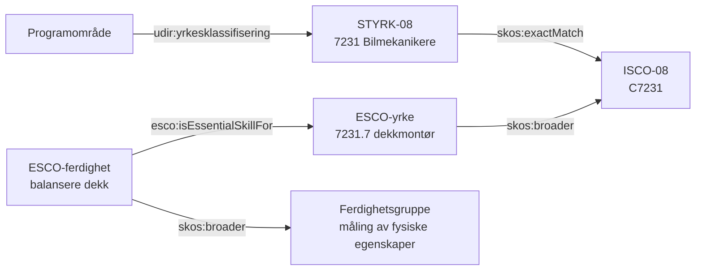

# ESCO: yrker og ferdigheter

**ESCO** (European Skills, Competences, Qualifications and Occupations) er EU-kommisjonens klassifikasjon av
yrker og ferdigheter. Den beskriver hvert yrke med navn og definisjon, og sier hvilke ferdigheter og hvilken
kunnskap yrket krever. ESCO brukes blant annet i Europass og i den europeiske jobbportalen EURES, og er
oversatt til norsk.

STYRK-08 sier hvilken *gruppe* et yrke hører til. ESCO går ett nivå dypere: under gruppen Bilmekanikere ligger
ti yrker, fra dekkmontør til leder av serviceverksted, hvert med sine ferdigheter. Det er ESCO som gjør det
mulig å sammenligne en læreplan med det arbeidslivet etterspør.

Sandkassen har et **utdrag** av ESCO v1.2.1, på bokmål. Se [oversikten](oversikt.md) for helheten.

## Slik henger det sammen



## Yrkene

Sandkassen har alle ESCO-yrkene under de ISCO-gruppene programområdene er koblet til: 727 yrker under 105
grupper. Yrkene har ESCOs egne adresser.

```turtle
<http://data.europa.eu/esco/occupation/…> a skos:Concept, esco:Occupation ;
    skos:inScheme <http://data.europa.eu/esco/concept-scheme/occupations> ;
    skos:notation "7231.8" ;
    skos:prefLabel "servicetekniker, bil"@nb ;
    skos:definition "Serviceteknikere, bil utfører grunnleggende oppgaver, for eksempel å skifte olje …"@nb ;
    skos:broader <http://data.europa.eu/esco/isco/C7231> ;
    dcterms:source <https://esco.ec.europa.eu> .
```

| Egenskap | Innhold |
|---|---|
| `skos:notation` | ESCO-koden: ISCO-koden, punktum og et løpenummer |
| `skos:prefLabel` | Navnet på bokmål |
| `skos:definition` | Beskrivelsen av yrket, på bokmål |
| `skos:broader` | ISCO-gruppen, eller yrket over |

**Yrkene har egne nivåer.** De fleste ligger rett under en ISCO-gruppe (`7411.1` elektriker). Noen er
spesialiseringer av et annet yrke (`7411.1.1` installasjonselektriker), og da peker `skos:broader` på yrket
over. Bruk derfor `skos:broader+` når du vil ha alle yrkene under en gruppe.

**ESCO-yrkene til et programområde:**

```sparql
SELECT ?kode ?yrke ?beskrivelse WHERE {
  d:TPBMK3---- udir:yrkesklassifisering/skos:exactMatch ?isco .
  ?y skos:broader+ ?isco ; a esco:Occupation ;
     skos:notation ?kode ; skos:prefLabel ?yrke ; skos:definition ?beskrivelse .
} ORDER BY ?kode
```

**Søk etter et yrke på navn:**

```sparql
SELECT ?kode ?yrke WHERE {
  ?y a esco:Occupation ; skos:notation ?kode ; skos:prefLabel ?yrke .
  FILTER(CONTAINS(LCASE(?yrke), "elektriker"))
} ORDER BY ?kode
```

Fritekstindeksen i sandkassen dekker bare titlene i Grep, så her brukes `CONTAINS`.

**Hvilke programområder fører til et ESCO-yrke?** Motsatt vei, fra yrket til utdanningen:

```sparql
SELECT ?kode ?programomraade WHERE {
  ?y skos:prefLabel "installasjonselektriker"@nb ; skos:broader+ ?isco .
  ?p udir:yrkesklassifisering/skos:exactMatch ?isco ; u:kode ?kode ; u:tittel ?programomraade ;
     u:status st:publisert .
  FILTER(LANG(?programomraade) = "default")
} ORDER BY ?kode
```

Koblingen går via gruppen. Svaret er derfor programområdene som fører til *yrkesgruppen* yrket hører til, og
ikke nødvendigvis til akkurat dette yrket.

To ting mangler:

- **ISCO 7549** (Andre håndverkere) har ingen ESCO-yrker. Programområdene som er koblet dit, blant annet
  blomsterdekoratør, har derfor ingen yrker og ingen yrkesferdigheter.
- **Ett yrke**, vindturbintekniker, har ingen ferdigheter i ESCO v1.2.1.

## Ferdighetene

ESCO bruker «ferdighet» (skill) om to ting, og skiller dem med `esco:skillType`:

| Type | Betyr | Eksempel | Antall |
|---|---|---|---|
| ferdighet | noe man kan gjøre | *balansere dekk* | 5 082 |
| kunnskap | noe man vet | *hybridbilarkitektur* | 1 520 |

I tillegg sier `esco:skillReuseLevel` hvor bredt ferdigheten brukes:

| Gjenbruksnivå | Betyr | Antall |
|---|---|---|
| yrkesspesifikk | brukes i ett yrke eller noen få | 935 |
| sektorspesifikk | brukes innenfor én sektor | 3 540 |
| sektorovergripende | brukes i flere sektorer | 2 007 |
| tverrgående (*transversal*) | brukes i nesten alle yrker, for eksempel *løse konflikter* | 120 |

Sandkassen har 6 606 ferdigheter: alle som er knyttet til de 727 yrkene, og alle de 120 tverrgående, også de
som ikke er knyttet til noe yrke. Språkferdighetene er ikke med. Fire ferdigheter om digital kompetanse har
verken type eller gjenbruksnivå i ESCO og mangler derfor i tabellene over.

```turtle
<http://data.europa.eu/esco/skill/…> a skos:Concept, esco:Skill ;
    skos:prefLabel "balansere dekk"@nb ;
    skos:definition "Måle statisk og dynamisk balanse i dekk ved hjelp av følere …"@nb ;
    skos:broader <http://data.europa.eu/esco/skill/…> ;          # ferdighetsgruppen
    esco:skillType <http://data.europa.eu/esco/skill-type/skill> ;
    esco:skillReuseLevel <http://data.europa.eu/esco/skill-reuse-level/sector-specific> ;
    esco:isEssentialSkillFor <http://data.europa.eu/esco/occupation/…> .
```

| Egenskap | Innhold |
|---|---|
| `skos:prefLabel` | Navnet på bokmål |
| `skos:altLabel` | Andre navn på samme ferdighet |
| `skos:definition` | Beskrivelsen |
| `esco:skillType` | Ferdighet eller kunnskap |
| `esco:skillReuseLevel` | Gjenbruksnivået |
| `skos:broader` | Ferdighetsgruppen, en bredere ferdighet eller et fagfelt i ISCED-F |
| `esco:isEssentialSkillFor` | Yrker der ferdigheten er essensiell |
| `esco:isOptionalSkillFor` | Yrker der ferdigheten er valgfri |

Typene og nivåene er egne ressurser med norske navn, så du kan vise dem med `skos:prefLabel`.

**Antall ferdigheter per type og gjenbruksnivå:**

```sparql
SELECT ?type ?gjenbruk (COUNT(?f) AS ?antall) WHERE {
  ?f a esco:Skill ; esco:skillType/skos:prefLabel ?type ; esco:skillReuseLevel/skos:prefLabel ?gjenbruk .
} GROUP BY ?type ?gjenbruk ORDER BY ?type DESC(?antall)
```

## Fra ferdighet til yrke

Koblingen går **fra ferdigheten til yrket**, slik ESCO har den:

| Relasjon | Betyr | Antall |
|---|---|---|
| `esco:isEssentialSkillFor` | yrket krever ferdigheten | 13 848 |
| `esco:isOptionalSkillFor` | ferdigheten kan være aktuell, avhengig av arbeidsgiver og spesialisering | 12 802 |

Et yrke har i snitt 19 essensielle ferdigheter. Start derfor spørringen fra ferdigheten, eller skriv
trippelet med ferdigheten først.

**Ferdighetene til ett yrke**, med type og om de er essensielle:

```sparql
SELECT ?krav ?type ?ferdighet WHERE {
  ?y skos:prefLabel "servicetekniker, bil"@nb .
  ?f ?r ?y ; skos:prefLabel ?ferdighet ; esco:skillType/skos:prefLabel ?type .
  VALUES (?r ?krav) { (esco:isEssentialSkillFor "essensiell") (esco:isOptionalSkillFor "valgfri") }
} ORDER BY ?krav ?type ?ferdighet
```

**Ferdighetene flest yrker krever:**

```sparql
SELECT ?ferdighet (COUNT(DISTINCT ?y) AS ?yrker) WHERE {
  ?f esco:isEssentialSkillFor ?y ; skos:prefLabel ?ferdighet .
} GROUP BY ?ferdighet ORDER BY DESC(?yrker) LIMIT 15
```

Tallene gjelder yrkene i sandkassen, altså yrkene fagopplæringen fører til, og ikke hele ESCO.

**Hva har to yrker til felles?**

```sparql
SELECT ?ferdighet WHERE {
  ?a skos:prefLabel "servicetekniker, bil"@nb .
  ?b skos:prefLabel "kjøretøytekniker"@nb .
  ?f esco:isEssentialSkillFor ?a , ?b ; skos:prefLabel ?ferdighet .
} ORDER BY ?ferdighet
```

**Ferdighetsprofilen til et programområde.** De essensielle ferdighetene for yrkene programområdet fører til,
med hvor mange av yrkene som krever dem:

```sparql
SELECT ?ferdighet ?type (COUNT(DISTINCT ?y) AS ?yrker) WHERE {
  d:TPBMK3---- udir:yrkesklassifisering/skos:exactMatch ?isco .
  ?y skos:broader+ ?isco .
  ?f esco:isEssentialSkillFor ?y ; skos:prefLabel ?ferdighet ; esco:skillType/skos:prefLabel ?type .
} GROUP BY ?ferdighet ?type ORDER BY DESC(?yrker) ?ferdighet
```

## Ferdighetshierarkiet

Ferdighetene er ordnet i grupper med `skos:broader`, i flere nivåer. Øverst står tre grupper: *ferdigheter*,
*kunnskap* og *tverrgående ferdigheter og kompetanser*. Gruppene er `skos:Concept`, men ikke `esco:Skill`.

**Veien opp fra en ferdighet:**

```sparql
SELECT DISTINCT ?gruppe WHERE {
  ?f skos:prefLabel "balansere dekk"@nb ; skos:broader+ ?g .
  ?g skos:prefLabel ?gruppe .
}
```

**De tverrgående ferdighetene**, gruppert:

```sparql
SELECT ?gruppe ?ferdighet WHERE {
  ?f a esco:Skill ; skos:prefLabel ?ferdighet ; skos:broader ?g ;
     esco:skillReuseLevel <http://data.europa.eu/esco/skill-reuse-level/transversal> .
  ?g skos:prefLabel ?gruppe .
} ORDER BY ?gruppe ?ferdighet
```

De tverrgående ferdighetene ligner på det læreplanverket kaller grunnleggende ferdigheter og tverrfaglige
temaer: kommunisere, arbeide med tall, ta vare på helse og miljø, utøve medborgerskap. De er derfor kandidater
for alle kompetansemål, se [Kompetansemål og ESCO-ferdigheter](km-esco.md).

**Kunnskap og fagfelt.** Kunnskapsferdighetene er ordnet under fagfeltene i ISCED-F 2013, de samme fagfeltene
som NUS-kodene peker til. Antall kunnskapsferdigheter per fagfelt:

```sparql
SELECT ?fagfelt (COUNT(?f) AS ?antall) WHERE {
  ?f a esco:Skill ; skos:broader ?i .
  FILTER(STRSTARTS(STR(?i), STR(iscedf:)))
  ?i skos:prefLabel ?fagfelt .
} GROUP BY ?fagfelt ORDER BY DESC(?antall)
```

Det gir en vei fra utdanningen til kunnskapen i fagfeltet, uten å gå via yrket. Se
[Utdanninger: NUS og ISCED](nus.md#fra-utdanning-til-kunnskap).

## Hva som ikke er med

| Ikke med | Merknad |
|---|---|
| Yrker utenfor fagopplæringen | Bare yrkene under ISCO-gruppene programområdene er koblet til |
| Ferdigheter som ikke hører til disse yrkene | Unntatt de tverrgående, som alle er med |
| Språkferdighetene | Tatt ut av de tverrgående |
| Andre språk enn bokmål | ESCO merker norsk med `no`. Det er bokmål, og sandkassen merker det `nb`. |
| Andre navn på yrkene (`skos:altLabel`) | Bare ferdighetene har dem |
| Kvalifikasjonene i ESCO | Ikke lastet inn |
| Navn på ISCO-gruppene | Bruk navnet på STYRK-gruppen, se [STYRK-08](styrk.md#isco-08-broen-til-europa) |

## Vedlikehold

ESCO har ikke noe åpent SPARQL-endepunkt. Yrkene hentes fra ESCO-API-et med `scripts/lag-esco-ttl.py`.
Ferdighetene hentes fra den nedlastede klassifikasjonen med `scripts/lag-esco-ferdigheter-ttl.py`. Begge
kjøres for hånd, og resultatet ligger i `ontologi/koblinger/esco-yrker.ttl` og `esco-ferdigheter.ttl`.

Filen med ferdigheter har én trippel per linje og er sortert, slik at endringene mellom to ESCO-versjoner kan
leses rett ut av historikken i repoet. Den nattlige jobben melder et avvik når ESCO har publisert en nyere
versjon enn den sandkassen bruker.

## Vilkår

> **This service uses the ESCO classification of the European Commission.** (Denne tjenesten bruker
> EU-kommisjonens ESCO-klassifikasjon.) Sandkassen har en *endret* utgave av ESCO: bare et utdrag (yrkene under
> ISCO-gruppene programområdene er koblet til, og ferdighetene deres), og språkkoden er endret fra `no` til
> `nb`. Koblingene fra Grep til ESCO er sandkassens egne og ikke en del av ESCO. EU-kommisjonen garanterer ikke
> at ESCO, eller oversettelsene i ESCO, er riktige, oppdaterte eller fullstendige. Vilkår:
> [ESCO, Download](https://esco.ec.europa.eu/en/use-esco/download) (Kommisjonens beslutning 2011/833/EU om
> gjenbruk).
