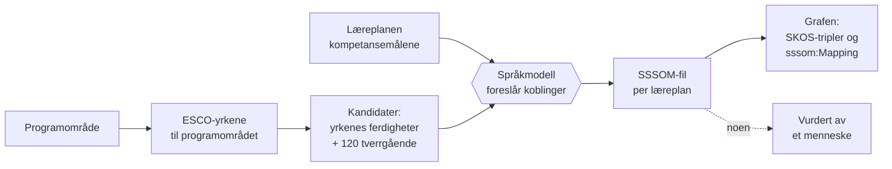

# Kompetansemål og ESCO-ferdigheter

Et kompetansemål sier hva lærlingen skal kunne. En ESCO-ferdighet sier hva et yrke krever. Kobler man de to,
kan man spørre om ting ingen av kildene svarer på alene: hvilke av yrkets ferdigheter læreplanen dekker, hvilke
den ikke dekker, og hvilke kompetansemål som ikke har noe motstykke i ESCO.

Sandkassen har slike koblinger for **alle de 223 gjeldende Vg3-læreplanene** som har en yrkeskobling: 23 940
koblinger fra 5 367 kompetansemål til 3 567 ESCO-ferdigheter.

> **Dette er et eksperiment.** Det finnes ingen offisiell kobling mellom norske læreplaner og ESCO. Koblingene
> er foreslått av en språkmodell, og de fleste er ikke vurdert av et menneske. De er sandkassens egne, og ikke
> en del av ESCO eller Grep.

Les [ESCO: yrker og ferdigheter](esco.md) først hvis ESCO er nytt for deg.

## Relasjonene

Koblingene bruker SKOS-relasjonene for koblinger mellom vokabularer. Relasjonen leses **fra kompetansemålet**:

| Relasjon | Betyr | Eksempel | Antall |
|---|---|---|---|
| `skos:closeMatch` | målet og ferdigheten er omtrent det samme | KM8647 (lavspenningssystemer) ↔ *reparere elektriske kjøretøysystemer* | 207 |
| `skos:narrowMatch` | ferdigheten er smalere: en del av målet | KM8640 (hjulutrustning) ↔ *balansere dekk* | 9 721 |
| `skos:broadMatch` | ferdigheten er bredere enn målet | KM10083 (bremser) ↔ *utføre reparasjoner av kjøretøy* | 427 |
| `skos:relatedMatch` | beslektet, men ikke en del av målet | KM8644 (drivlinjer) ↔ *hybridbilarkitektur* | 13 585 |

Kompetansemål er som regel bredere enn ESCO-ferdigheter. Derfor er `narrowMatch` den vanligste av de tre som
sier at ferdigheten faktisk inngår i målet, og `closeMatch` er sjelden.

**Velg relasjon etter spørsmålet.** Spør du hva læreplanen *dekker*, bruker du `closeMatch` og `narrowMatch`,
og kanskje `broadMatch`. `relatedMatch` er over halvparten av koblingene og sier bare at de to har med
hverandre å gjøre. Tar du den med, får du mange treff som ikke betyr at ferdigheten læres.

```sparql
SELECT ?relasjon ?ferdighet ?type WHERE {
  d:KM8640 ?r ?f .
  ?f a esco:Skill ; skos:prefLabel ?ferdighet ; esco:skillType/skos:prefLabel ?type .
  VALUES ?r { skos:closeMatch skos:narrowMatch skos:broadMatch skos:relatedMatch }
  BIND(STRAFTER(STR(?r), "#") AS ?relasjon)
} ORDER BY ?relasjon ?ferdighet
```

KM8640 handler om hjulutrustning: å legge om dekk, avbalansere hjul og kontrollere dekktrykkvarsling.

## Hvordan koblingene er laget



1. **Kandidatene avgrenses.** For hver læreplan er kandidatene ferdighetene til ESCO-yrkene under ISCO-gruppen
   programområdet er koblet til, pluss ESCOs 120 tverrgående ferdigheter (utenom språk). Modellen velger altså
   ikke fritt blant alle ferdigheter i ESCO.
2. **En språkmodell foreslår koblinger**, ett kall per læreplan, med relasjon og en kort begrunnelse. De
   godkjente koblingene fra pilotene brukes som eksempler (`scripts/foreslaa-km-esco.py`).
3. **Forslagene lagres som SSSOM**, én fil per læreplan i
   [ontologi/koblinger/km-esco/](https://github.com/aremjolsnes/grep-jena-fuseki/tree/main/ontologi/koblinger/km-esco).
4. **Noen er vurdert av et menneske.** Forslag som blir avvist, flyttes til en egen fil og lastes ikke inn.
5. **Alle forslagene lastes inn**, også de som ikke er vurdert.

### Hvor mye er kvalitetssikret?

| Slag | Antall | Hva |
|---|---|---|
| Vurdert av et menneske | 454 | Pilotene BMK03-03 (120), HEA03-03 (115) og ELE03-04 (106), BKF03-02 (63) og en stikkprøve på 50 |
| Automatiske, ikke vurdert | 23 486 | Resten |

I pilotene ble alle forslagene et menneske vurderte, godtatt. Etterpå ble en tilfeldig stikkprøve på 50
automatiske koblinger fra 50 ulike læreplaner vurdert, og alle 50 var riktige. Det betyr at minst 93 % av de
automatiske koblingene er riktige (95 % konfidensintervall). Sandkassen tar derfor med de automatiske
koblingene og retter heller i etterkant.

Det stikkprøven sier noe om, er om en kobling som *finnes*, er riktig. Den sier ikke om koblinger *mangler*.

## SSSOM: koblingen som egen ressurs

En SKOS-trippel sier at to begreper hører sammen. Den sier ikke hvem som har sagt det, hvorfor, eller om noen
har kontrollert det. Til det bruker sandkassen [SSSOM](https://mapping-commons.github.io/sssom/) (Simple
Standard for Sharing Ontological Mappings), en standard for å beskrive koblinger mellom vokabularer.

Hver kobling finnes derfor to ganger:

```turtle
# 1. Den direkte trippelen, som er lett å spørre på
d:KM8640 skos:narrowMatch <http://data.europa.eu/esco/skill/36576c3d-…> .

# 2. Koblingen som egen ressurs, med opplysninger om koblingen
<http://psi.udir.no/kl06/kobling/km-esco/BMK03-03/KM8640/36576c3d-…> a sssom:Mapping ;
    sssom:mapping_set <http://psi.udir.no/kl06/kobling/km-esco/BMK03-03> ;
    sssom:subject_id d:KM8640 ;
    sssom:predicate_id skos:narrowMatch ;
    sssom:object_id <http://data.europa.eu/esco/skill/36576c3d-…> ;
    sssom:mapping_justification semapv:ManualMappingCuration ;
    sssom:author_label "Claude (språkmodell, forslag)" ;
    sssom:reviewer_label "Are Mjølsnes" ;
    sssom:mapping_tool "Claude (Anthropic)" .
```

| Egenskap | Innhold |
|---|---|
| `sssom:subject_id` | Kompetansemålet |
| `sssom:predicate_id` | Relasjonen (`skos:narrowMatch` …) |
| `sssom:object_id` | ESCO-ferdigheten |
| `sssom:mapping_set` | Koblingssettet, ett per læreplan |
| `sssom:author_label` | Hvem som foreslo koblingen |
| `sssom:reviewer_label` | Hvem som har vurdert den. **Mangler på de automatiske.** |
| `sssom:mapping_tool` | Verktøyet, med modellnavnet for de automatiske |
| `sssom:comment` | Begrunnelsen. For de automatiske begynner den med «Automatisk forslag». |
| `sssom:mapping_justification` | Hvordan koblingen ble til |

`sssom:mapping_justification` er `semapv:ManualMappingCuration` på alle koblingene, også de automatiske. Den
kan derfor ikke brukes til å skille dem. Bruk `sssom:reviewer_label`.

**Koblingssettet** (`sssom:MappingSet`) beskriver koblingene for én læreplan: tittel, lisens (NLOD 2.0), dato
og hvilken ESCO-versjon de er laget mot.

```sparql
SELECT ?egenskap ?verdi WHERE {
  <http://psi.udir.no/kl06/kobling/km-esco/BMK03-03> ?egenskap ?verdi .
}
```

## Spørringer

**Koblingene til et kompetansemål, med begrunnelse:**

```sparql
SELECT ?relasjon ?ferdighet ?vurdertAv ?begrunnelse WHERE {
  ?m a sssom:Mapping ; sssom:subject_id d:KM10083 ; sssom:predicate_id ?r ; sssom:object_id ?f .
  ?f skos:prefLabel ?ferdighet .
  OPTIONAL { ?m sssom:reviewer_label ?vurdertAv }
  OPTIONAL { ?m sssom:comment ?begrunnelse }
  BIND(STRAFTER(STR(?r), "#") AS ?relasjon)
} ORDER BY ?relasjon ?ferdighet
```

**Bare koblinger et menneske har vurdert:**

```sparql
SELECT ?km ?relasjon ?ferdighet ?vurdertAv WHERE {
  ?m a sssom:Mapping ; sssom:subject_id ?km ; sssom:predicate_id ?r ; sssom:object_id ?f ;
     sssom:reviewer_label ?vurdertAv .
  ?f skos:prefLabel ?ferdighet .
  BIND(STRAFTER(STR(?r), "#") AS ?relasjon)
} ORDER BY ?km LIMIT 100
```

**Status per læreplan:** hvor mange koblinger, og hvor mange som er vurdert.

```sparql
SELECT ?laereplan (COUNT(?m) AS ?koblinger) (COUNT(?v) AS ?vurdert) WHERE {
  ?m a sssom:Mapping ; sssom:mapping_set ?sett .
  OPTIONAL { ?m sssom:reviewer_label ?v }
  BIND(STRAFTER(STR(?sett), "km-esco/") AS ?laereplan)
} GROUP BY ?laereplan ORDER BY DESC(?vurdert) ?laereplan
```

**Hele læreplanen:** kompetansemålene med ferdighetene de dekker, uten de beslektede.

```sparql
SELECT ?kode ?relasjon ?ferdighet WHERE {
  d:BMK03-03 u:kompetansemaalsett/u:kompetansemaal ?km .
  ?km u:kode ?kode ; ?r ?f .
  ?f a esco:Skill ; skos:prefLabel ?ferdighet .
  VALUES ?r { skos:closeMatch skos:narrowMatch }
  BIND(STRAFTER(STR(?r), "#") AS ?relasjon)
} ORDER BY ?kode ?ferdighet
```

## Hull: det ene finnes uten det andre

Det mest interessante er ofte det som *ikke* er koblet.

**Hull 1: kompetansemål uten ESCO-ferdighet.** Hva skal lærlingen kunne som ESCO ikke har noe ord for?

```sparql
SELECT ?kode ?tekst WHERE {
  d:ROM03-02 u:kompetansemaalsett/u:kompetansemaal ?km .
  ?km u:kode ?kode ; udir:bokmaalTittel ?tekst .
  FILTER NOT EXISTS {
    ?km skos:closeMatch|skos:narrowMatch|skos:broadMatch|skos:relatedMatch ?f . ?f a esco:Skill
  }
}
```

Eksempelet er læreplanen i romteknologi (ROM03-02). Bytt læreplankoden for å se andre. I de 223 læreplanene er
216 kompetansemål uten kobling. Det er ofte spesialiserte arbeidsoppgaver som ESCO-yrkene ikke beskriver, for
eksempel å lodde blyinnfattede vinduer eller å bygge spor på bruer. Mange læreplaner har ingen slike hull.

**Hull 2: essensielle ferdigheter uten kompetansemål.** Hva krever yrkene som læreplanen ikke nevner?

```sparql
SELECT ?ferdighet (COUNT(DISTINCT ?y) AS ?antallYrker) WHERE {
  d:TPBMK3---- udir:yrkesklassifisering/skos:exactMatch ?isco .
  ?y skos:broader+ ?isco .
  ?f esco:isEssentialSkillFor ?y ; skos:prefLabel ?ferdighet .
  FILTER NOT EXISTS {
    d:BMK03-03 u:kompetansemaalsett/u:kompetansemaal ?km .
    ?km skos:closeMatch|skos:narrowMatch|skos:broadMatch|skos:relatedMatch ?f
  }
} GROUP BY ?ferdighet ORDER BY DESC(?antallYrker) ?ferdighet
```

Programområdet og læreplanen må stå sammen i spørringen, her `d:TPBMK3----` og `d:BMK03-03`.

**Dekning per yrke.** Samme spørsmål som tall: hvor mange av de essensielle ferdighetene til hvert yrke har et
kompetansemål i læreplanen?

```sparql
SELECT ?yrke (COUNT(DISTINCT ?f) AS ?essensielle) (COUNT(DISTINCT ?dekket) AS ?iLaereplanen) WHERE {
  d:TPBMK3---- udir:yrkesklassifisering/skos:exactMatch ?isco .
  ?y skos:broader+ ?isco ; skos:prefLabel ?yrke .
  ?f esco:isEssentialSkillFor ?y .
  OPTIONAL {
    d:BMK03-03 u:kompetansemaalsett/u:kompetansemaal ?km .
    ?km skos:closeMatch|skos:narrowMatch|skos:broadMatch|skos:relatedMatch ?f .
    BIND(?f AS ?dekket)
  }
} GROUP BY ?yrke ORDER BY DESC(?iLaereplanen)
```

### Slik leser du et hull

Et hull betyr «ikke funnet blant kandidatene», og ikke nødvendigvis at noe mangler i læreplanen.

- **Yrkesgruppen er bredere enn faget.** Under ISCO 7231 ligger både dekkmontør og leder av serviceverksted.
  Læreplanen for bilfaget, lette kjøretøy skal ikke dekke alt en verkstedleder må kunne.
- **Læreplanen er skrevet på et annet nivå.** Et kompetansemål kan dekke en ferdighet uten å nevne den.
- **Kandidatene er avgrenset.** En ferdighet som verken hører til yrkene eller er tverrgående, er aldri
  vurdert. *Arbeide ergonomisk* for helsearbeiderfaget ble lagt inn for hånd av den grunn.
- **Ikke alle yrker har ESCO-yrker.** ESCO har ingen yrker under ISCO 7549, der blant annet blomsterdekoratør
  hører hjemme. BLD03-03 og BLD05-01 er derfor bare koblet til de tverrgående ferdighetene.

## På tvers av læreplanene

**Ferdighetene flest læreplaner dekker:**

```sparql
SELECT ?ferdighet (COUNT(DISTINCT ?lp) AS ?laereplaner) WHERE {
  ?km skos:closeMatch|skos:narrowMatch ?f ; u:tilhoerer-laereplan ?lp .
  ?f a esco:Skill ; skos:prefLabel ?ferdighet .
} GROUP BY ?ferdighet ORDER BY DESC(?laereplaner) LIMIT 15
```

Øverst står tverrgående ferdigheter som *planlegge* og *overholde forskrifter*. Omtrent 7 200 av koblingene går
til de tverrgående ferdighetene.

**Hva har to læreplaner til felles?** Ferdigheter som både lette og tunge kjøretøy dekker:

```sparql
SELECT DISTINCT ?ferdighet WHERE {
  ?a u:tilhoerer-laereplan d:BMK03-03 ; skos:closeMatch|skos:narrowMatch ?f .
  ?b u:tilhoerer-laereplan d:BTK03-02 ; skos:closeMatch|skos:narrowMatch ?f .
  ?f skos:prefLabel ?ferdighet ; esco:skillReuseLevel ?nivaa .
  FILTER(?nivaa != <http://data.europa.eu/esco/skill-reuse-level/transversal>)
} ORDER BY ?ferdighet
```

Filteret tar bort de tverrgående ferdighetene, som nesten alle læreplaner deler.

**Fra et ESCO-yrke til kompetansemålene.** Hvilke kompetansemål i læreplanen bygger opp under ett bestemt yrke?

```sparql
SELECT ?kode (COUNT(DISTINCT ?f) AS ?ferdigheter) WHERE {
  ?y skos:prefLabel "dekkmontør"@nb .
  ?f esco:isEssentialSkillFor ?y .
  d:BMK03-03 u:kompetansemaalsett/u:kompetansemaal ?km .
  ?km skos:closeMatch|skos:narrowMatch|skos:broadMatch ?f ; u:kode ?kode .
} GROUP BY ?kode ORDER BY DESC(?ferdigheter)
```

## Vedlikehold

Kilden er SSSOM-filene (`*.sssom.tsv`). `scripts/lag-km-esco-ttl.py` lager `ontologi/koblinger/km-esco.ttl` av
dem, og den lastes inn i `urn:graph:koblinger`. En rettelse gjøres i SSSOM-filen:

| Vil | Gjør |
|---|---|
| Rette en relasjon | Endre `predicate_id` i raden |
| Godkjenne en kobling | Sett navnet ditt i `reviewer_label` |
| Avvise en kobling | Flytt raden til `<læreplan>.avvist.tsv`. Den filen lastes ikke inn. |
| Legge til en kobling | Legg til en rad |

Skal mange koblinger vurderes, lager `scripts/foreslaa-km-esco.py` en arbeidsliste til Excel, og
`scripts/godkjenn-km-esco.py` fører vurderingene tilbake i SSSOM-filene.

Koblingene er laget mot ESCO v1.2.1. Kommer det en ny ESCO-versjon, må koblinger til ferdigheter som er tatt ut
eller slått sammen, gås gjennom på nytt.
