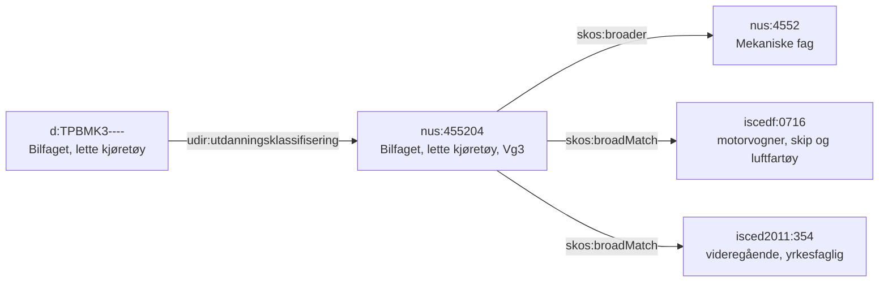
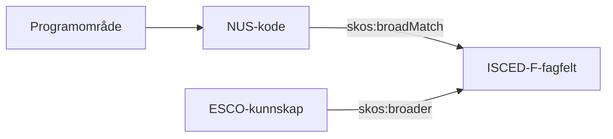

# Utdanninger: NUS og ISCED

Et programområde er en utdanning, og utdanninger klassifiseres i statistikken. I Norge gjør SSB det med **NUS**,
Norsk standard for utdanningsgruppering. Internasjonalt brukes **ISCED** fra UNESCO, som har én klassifisering
for fagfelt og én for nivå. Sandkassen kobler programområdene til NUS, og NUS videre til ISCED, slik at Grep
kan settes sammen med utdanningsstatistikk og med europeiske data.

Yrkeskoblingen ([STYRK-08](styrk.md)) gjelder bare Vg3 i yrkesfag. Utdanningskoblingen gjelder **alle
programområdene**, også Vg1, Vg2 og de studieforberedende.

Se [oversikten](oversikt.md) for helheten.



## Hva NUS er

NUS grupperer norske utdanninger på alle nivåer, fra grunnskole til doktorgrad, med en sekssifret kode. Sifrene har
betydning, og koden kan leses fra venstre:

| Siffer | Nivå i NUS | Eksempel | I sandkassen |
|---|---|---|---|
| 1 | Nivå | `4` Videregående, avsluttende utdanning | 2 |
| 2 | Fagfelt | `45` Naturvitenskapelige fag, håndverksfag og tekniske fag | 16 |
| 3 | Faggruppe | `455` Utdanninger i elektrofag, mekaniske fag og maskinfag | 50 |
| 4 | Utdanningsgruppe | `4552` Mekaniske fag | 89 |
| 6 | Enkeltutdanning | `455204` Bilfaget, lette kjøretøy, Vg3 | 436 |

Sandkassen har bare den delen av NUS som programområdene bruker: 436 enkeltutdanninger og de 157 gruppene over
dem. Av nivåene er det derfor bare to:

| Nivå | Betyr | Programområder |
|---|---|---|
| `3` | Videregående, grunnutdanning (Vg1 og Vg2) | 147 |
| `4` | Videregående, avsluttende utdanning (Vg3) | 344 |

## Slik ligger den i sandkassen

NUS er et SKOS-begrepssystem, `udir:Nus`:

```turtle
nus:455204 a skos:Concept ;
    skos:inScheme udir:Nus ;
    skos:notation "455204" ;
    skos:prefLabel "Bilfaget, lette kjøretøy, Vg3"@nb ;
    skos:broader nus:4552 ;
    skos:broadMatch iscedf:0716 , isced2011:354 .
```

| Egenskap | Innhold |
|---|---|
| `skos:notation` | NUS-koden |
| `skos:prefLabel` | Navnet på bokmål, slik SSB har det |
| `skos:broader` | Gruppen over |
| `skos:broadMatch` | Fagfeltet i ISCED-F 2013 og nivået i ISCED 2011 |

**Adressene er sandkassens egne**, `http://psi.udir.no/ontologi/nus/` pluss koden, fordi SSB ikke har faste
adresser for kodene. Kilden er SSBs KLASS, klassifikasjon 36. Hvilken NUS-versjon sandkassen bruker, står på
begrepssystemet:

```sparql
SELECT ?versjon WHERE { udir:Nus owl:versionInfo ?versjon }
```

**Veien opp fra et programområde:**

```sparql
SELECT ?kode ?navn WHERE {
  d:TPBMK3---- udir:utdanningsklassifisering/skos:broader* ?g .
  ?g skos:notation ?kode ; skos:prefLabel ?navn .
} ORDER BY ?kode
```

## Koblingen fra programområdene

`udir:utdanningsklassifisering` går fra et programområde til enkeltutdanningen i NUS. **491 av 497**
programområder har en kobling.

> Det finnes ingen offisiell tabell fra programområde til NUS. Koblingen er sandkassens forslag.

| Metode | Antall | Betyr |
|---|---|---|
| `ssb-navn` | 421 | Programområdet har samme navn og trinn som NUS-koden, for eksempel «Bilfaget, lette kjøretøy» på Vg3 og NUS 455204 «Bilfaget, lette kjøretøy, Vg3» |
| `som-vanlig-utgave` | 29 | Varianter for Steinerskolen, Montessori og Den tyske skole. De får samme kode som den vanlige utgaven av programområdet. |
| `forslag` | 20 | Navnet er ikke helt likt, men koblingen er regnet som sikker |
| `manuell` | 21 | Navnet stemte ikke. Vurdert av et menneske. |
| `ingen` | 6 | Uten kobling, for eksempel plassholdere fra Reform 94 |

Metoden står i kilden, [nus.csv](https://github.com/aremjolsnes/grep-jena-fuseki/blob/main/ontologi/koblinger/nus.csv),
og er ikke med i grafen.

Tre ting å vite:

- **Ny og gammel ordning.** Finnes utdanningen i NUS både i ny og gammel ordning, får utgåtte programområder
  koden for gammel ordning og publiserte koden for ny.
- **Eldre navn.** Har NUS ikke fått det nye navnet, er koden for en eldre utgave: «Sykkelmekanikerfaget» er
  koblet til NUS 455240 «Sykkelreparatør, VK II».
- **Flere programområder kan ha samme kode.** Seks programområder er koblet til «Studiespesialisering, Vg1».

**Programområder uten kobling:**

```sparql
SELECT ?kode ?tittel WHERE {
  ?p a u:Programomraade ; u:kode ?kode ; u:tittel ?tittel .
  FILTER(LANG(?tittel) = "default")
  FILTER NOT EXISTS { ?p udir:utdanningsklassifisering ?n }
} ORDER BY ?kode
```

**NUS-koder som flere programområder deler:**

```sparql
SELECT ?nus ?utdanning (COUNT(?p) AS ?antall) WHERE {
  ?p udir:utdanningsklassifisering ?n .
  ?n skos:notation ?nus ; skos:prefLabel ?utdanning .
} GROUP BY ?nus ?utdanning HAVING(COUNT(?p) > 1) ORDER BY DESC(?antall)
```

**Et helt utdanningsprogram**, med NUS-koden for hvert programområde som gjelder i dag:

```sparql
SELECT ?kode ?programomraade ?nus ?utdanning WHERE {
  ?p u:utdanningsprogram-referanse d:TP ; u:status st:publisert ;
     u:kode ?kode ; u:tittel ?programomraade ; udir:utdanningsklassifisering ?n .
  FILTER(LANG(?programomraade) = "default")
  ?n skos:notation ?nus ; skos:prefLabel ?utdanning .
} ORDER BY ?nus
```

`d:TP` er Teknologi- og industrifag. Sortert på NUS-koden kommer Vg1 og Vg2 først (nivå 3) og Vg3 etterpå
(nivå 4).

## ISCED-F 2013: fagfeltet

ISCED-F er UNESCOs klassifisering av fagfelt (*fields of education and training*). Den har tre nivåer:

| Nivå | Siffer | Eksempel | I sandkassen |
|---|---|---|---|
| Bredt fagfelt | 2 | `07` maskinteknikk, produksjon og bygg | 11 |
| Smalt fagfelt | 3 | `071` tekniske fag og ingeniørfag | 33 |
| Detaljert fagfelt | 4 | `0716` motorvogner, skip og luftfartøy | 81 |

Adressene og de norske navnene er ESCOs, for ESCO publiserer ISCED-F som en del av sin klassifikasjon:
`iscedf:0716` er `http://data.europa.eu/esco/isced-f/0716`. Nivåene henger sammen med `skos:broader`.

NUS-kodene peker til det detaljerte fagfeltet med `skos:broadMatch`, etter SSBs korrespondansetabell. Relasjonen
er «bredere» fordi fagfeltet favner mer enn den ene utdanningen. 429 av de 436 kodene har en slik kobling, til
44 ulike fagfelt.

**Programområder per bredt fagfelt:**

```sparql
SELECT ?kode ?fagfelt (COUNT(DISTINCT ?p) AS ?antall) WHERE {
  ?p udir:utdanningsklassifisering/skos:broadMatch/skos:broader* ?b .
  FILTER(REGEX(STR(?b), "isced-f/[0-9]{2}$"))
  ?b skos:prefLabel ?fagfelt .
  BIND(STRAFTER(STR(?b), STR(iscedf:)) AS ?kode)
} GROUP BY ?kode ?fagfelt ORDER BY DESC(?antall)
```

Stien går fra programområdet til NUS-koden, over til ISCED-F og opp til det brede fagfeltet. Filteret velger
adressene med to siffer.

**Alle programområdene i ett fagfelt**, på tvers av utdanningsprogram:

```sparql
SELECT ?kode ?tittel ?detaljert WHERE {
  ?p udir:utdanningsklassifisering/skos:broadMatch ?f ; u:kode ?kode ; u:tittel ?tittel ;
     u:status st:publisert .
  ?f skos:broader* iscedf:071 ; skos:prefLabel ?detaljert .
  FILTER(LANG(?tittel) = "default")
} ORDER BY ?detaljert ?kode
```

## ISCED 2011: nivået

ISCED 2011 klassifiserer utdanningsnivå. NUS-kodene peker til nivået for fullført utdanning (*attainment*),
også med `skos:broadMatch` og etter SSBs korrespondansetabell. Fem nivåer er i bruk:

| Kode | Betyr | Programområder |
|---|---|---|
| `244` | Fullført ungdomstrinn, med adgang til videregående | 109 |
| `343` | Videregående, allmennfaglig, uten direkte adgang til høyere utdanning | 1 |
| `344` | Videregående, allmennfaglig, med adgang til høyere utdanning | 35 |
| `353` | Videregående, yrkesfaglig, uten direkte adgang til høyere utdanning | 1 |
| `354` | Videregående, yrkesfaglig, med adgang til høyere utdanning | 338 |

Første siffer er nivået (2 er ungdomstrinn, 3 er videregående), andre siffer er retningen (4 er allmennfaglig,
5 er yrkesfaglig), og tredje sier om nivået er fullført og hva det gir adgang til. Av de 119 NUS-kodene for Vg1
og Vg2 peker 84 til 244, og de fleste andre til 354.

**Adressene er sandkassens egne** (`isced2011:`), i begrepssystemet `udir:Isced2011`. EU har adresser for
ISCED 2011, men de virket ikke da koblingen ble laget. Navnene er på engelsk.

**Programområder per ISCED-nivå:**

```sparql
SELECT ?isced ?nivaa (COUNT(DISTINCT ?p) AS ?antall) WHERE {
  ?p udir:utdanningsklassifisering/skos:broadMatch ?n .
  ?n skos:inScheme udir:Isced2011 ; skos:notation ?isced ; skos:prefLabel ?nivaa .
} GROUP BY ?isced ?nivaa ORDER BY ?isced
```

**NUS-koder som mangler ISCED.** Sju koder står ikke i SSBs korrespondansetabeller:

```sparql
SELECT ?kode ?navn WHERE {
  ?n skos:inScheme udir:Nus ; skos:notation ?kode ; skos:prefLabel ?navn .
  FILTER(STRLEN(?kode) = 6)
  FILTER NOT EXISTS { ?n skos:broadMatch ?x }
} ORDER BY ?kode
```

Fordi fagfelt og nivå begge er `skos:broadMatch`, må du skille dem når du vil ha bare den ene. Bruk
`skos:inScheme udir:Isced2011` for nivået, og adressen for fagfeltet:

```sparql
SELECT ?kode ?tittel ?nus ?fagfelt ?nivaa WHERE {
  ?p u:kode ?kode ; u:tittel ?tittel ; udir:utdanningsklassifisering ?n .
  FILTER(LANG(?tittel) = "default" && STRSTARTS(?tittel, "Bilfaget"))
  ?n skos:notation ?nus .
  OPTIONAL { ?n skos:broadMatch ?f . FILTER(STRSTARTS(STR(?f), STR(iscedf:))) ?f skos:prefLabel ?fagfelt }
  OPTIONAL { ?n skos:broadMatch ?l . ?l skos:inScheme udir:Isced2011 ; skos:notation ?nivaa }
} ORDER BY ?kode
```

## Fra utdanning til kunnskap

ESCO ordner kunnskapsferdighetene sine under de samme ISCED-F-fagfeltene. Dermed går det en vei fra
utdanningen til kunnskapen i fagfeltet, uten å gå via yrket:



```sparql
SELECT DISTINCT ?fagfelt ?kunnskap WHERE {
  d:TPBMK3---- udir:utdanningsklassifisering/skos:broadMatch ?f .
  FILTER(STRSTARTS(STR(?f), STR(iscedf:)))
  ?f skos:prefLabel ?fagfelt .
  ?k a esco:Skill ; skos:broader ?f ; skos:prefLabel ?kunnskap .
} ORDER BY ?kunnskap LIMIT 50
```

Dette er en grovere kobling enn yrkesveien. Fagfeltet «motorvogner, skip og luftfartøy» rommer kunnskap om
både biler, skip og fly. Bruk den som en utvidelse, for eksempel for programområder uten yrkeskobling.

## Yrke og utdanning sammen

Et programområde på Vg3 har som regel begge koblingene:

```sparql
SELECT ?kode ?nus ?utdanning ?styrk ?yrke WHERE {
  ?p u:kode ?kode ; u:status st:publisert ;
     udir:utdanningsklassifisering ?n ; udir:yrkesklassifisering ?k .
  ?n skos:notation ?nus ; skos:prefLabel ?utdanning .
  ?k skos:notation ?styrk ; skos:prefLabel ?yrke .
} ORDER BY ?nus LIMIT 50
```

Det gir en kobling mellom SSBs to klassifikasjoner via Grep: hvilke yrker (STYRK-08) de ulike
fagutdanningene (NUS) fører til.

## Vedlikehold

`nus.ttl` lages av `scripts/lag-nus-ttl.py` fra `nus.csv` og SSBs KLASS, med NUS-versjonen som gjelder når
skriptet kjøres. Hver natt kontrolleres det om SSB har tatt ut en kode som er i bruk, og om Grep har fått
programområder som ikke står i `nus.csv`. Begge deler meldes som avvik.
