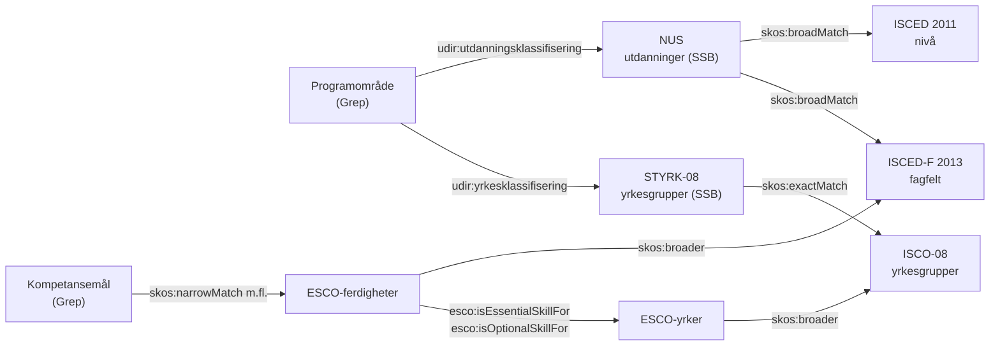

# Koblede kunnskapsgrafer: oversikt

Grep beskriver opplæringen: læreplaner, kompetansemål, fag og programområder. Grep sier lite om det som ligger
utenfor: hvilke yrker en utdanning fører til, hvordan den klassifiseres i statistikken, og hvilke ferdigheter
arbeidslivet etterspør. Det finnes det andre kunnskapsgrafer for. Sandkassen kobler Grep til dem, slik at én
spørring kan gå fra et kompetansemål til et yrke, eller fra et programområde til et europeisk fagfelt.

| Side | Innhold |
|---|---|
| **Oversikt** (denne siden) | Hva som er koblet, relasjonene, hvem som har laget hva |
| [Yrker: STYRK-08 og ISCO-08](styrk.md) | Programområdene koblet til SSBs yrkesklassifisering |
| [ESCO: yrker og ferdigheter](esco.md) | EUs klassifikasjon av yrker og ferdigheter |
| [Kompetansemål og ESCO-ferdigheter](km-esco.md) | Koblingene fra kompetansemål, med SSSOM |
| [Utdanninger: NUS og ISCED](nus.md) | Programområdene koblet til SSBs utdanningsgruppering |

Kodelistene inne i Grep (fagtyper, språk m.fl.) og koblingen til EUs språktabell står under
[Begrepssystemer (SKOS)](../ontologi/begrepssystemer.md).

## Kartet



Det er to veier ut av Grep:

- **Yrkesveien** går fra et programområde på Vg3 til yrkesgruppen i STYRK-08, videre til samme gruppe i ISCO-08
  og derfra til ESCOs yrker og ferdighetene de krever. Kompetansemålene i Vg3-læreplanene er koblet rett til
  ferdighetene.
- **Utdanningsveien** går fra et programområde, på alle trinn, til utdanningen i NUS, og videre til fagfelt og
  nivå i ISCED.

Veiene møtes i ISCED-F: ESCOs kunnskapsferdigheter er ordnet under de samme fagfeltene som NUS-kodene peker
til.

## Vokabularene

| Vokabular | Eier | Prefiks | I sandkassen | Antall |
|---|---|---|---|---|
| STYRK-08 | SSB | `styrk:` | Alle gruppene på fire nivåer | 582 |
| ISCO-08 | ILO, publisert av ESCO | `isco:` | Bare adressene, som bindeledd | 576 |
| ESCO-yrker | EU-kommisjonen | (ESCOs adresser) | Yrkene under ISCO-gruppene programområdene er koblet til | 727 |
| ESCO-ferdigheter | EU-kommisjonen | (ESCOs adresser) | Ferdighetene til yrkene, og alle tverrgående ferdigheter | 6 606 |
| NUS | SSB | `nus:` | Kodene programområdene bruker, og gruppene over | 593 |
| ISCED-F 2013 | UNESCO, publisert av ESCO | `iscedf:` | Fagfeltene | 125 |
| ISCED 2011 | UNESCO | `isced2011:` | Nivåene NUS-kodene peker til | 5 |
| EUs språktabell | EUs publikasjonskontor | (EUs adresser) | Bare adressene | 10 |

Alt ligger i grafen `urn:graph:koblinger`, omtrent 338 000 tripler. Unntaket er koblingen til EUs språktabell,
som utledes hver natt og ligger i `urn:graph:utledet`.

**Adressene.** Der eieren har faste adresser, bruker sandkassen dem: ESCO, ISCO-08, ISCED-F og EUs
språktabell. SSB har ikke faste adresser for kodene i STYRK-08 og NUS, og EUs adresser for ISCED 2011 virket
ikke. For dem lager sandkassen adresser selv, i `http://psi.udir.no/ontologi/`. De adressene er sandkassens
egne og ikke noe SSB eller Udir har vedtatt.

**Hva som finnes i grafen nå**, per type:

```sparql
SELECT ?type (COUNT(DISTINCT ?s) AS ?antall) WHERE {
  GRAPH <urn:graph:koblinger> { ?s a ?type }
} GROUP BY ?type ORDER BY DESC(?antall)
```

## Relasjonene

Nesten alt er uttrykt med SKOS. Det er to slags relasjoner, og forskjellen er viktig.

**Innenfor ett vokabular** brukes hierarkiet:

| Relasjon | Betyr | Eksempel |
|---|---|---|
| `skos:broader` | begrepet over | `styrk:7231` (Bilmekanikere) → `styrk:723` |
| `skos:inScheme` | begrepssystemet begrepet hører til | `styrk:7231` → `udir:Styrk08` |
| `skos:topConceptOf` | begrepet er øverst i systemet | `styrk:7` → `udir:Styrk08` |

**Mellom to vokabularer** brukes koblingsrelasjonene. De sier hvor godt to begreper svarer til hverandre:

| Relasjon | Betyr | Brukt på |
|---|---|---|
| `skos:exactMatch` | samme begrep | STYRK-08 → ISCO-08, språk → EUs språktabell |
| `skos:closeMatch` | omtrent det samme | kompetansemål → ESCO-ferdighet |
| `skos:broadMatch` | det andre begrepet er bredere | NUS → ISCED, kompetansemål → ESCO-ferdighet |
| `skos:narrowMatch` | det andre begrepet er smalere | kompetansemål → ESCO-ferdighet |
| `skos:relatedMatch` | beslektet, uten å være over eller under | kompetansemål → ESCO-ferdighet |

Relasjonen leses fra subjektet. `nus:455204 skos:broadMatch iscedf:0716` betyr at fagfeltet er bredere enn
NUS-koden.

To relasjoner er sandkassens egne og går ut av Grep:

| Relasjon | Fra | Til |
|---|---|---|
| `udir:yrkesklassifisering` | programområde | yrkesgruppe i STYRK-08 |
| `udir:utdanningsklassifisering` | programområde | utdanning i NUS |

Begge er beskrevet i ontologien (`ontologi/udir.ttl`). Fra ESCO kommer `esco:isEssentialSkillFor` og
`esco:isOptionalSkillFor`, som går fra ferdighet til yrke.

## Hvem har laget koblingene?

Vokabularene er offisielle. Koblingene mellom dem er av ulikt slag, og du bør vite hvilke du bygger på:

| Kobling | Antall | Kilde |
|---|---|---|
| STYRK-08 → ISCO-08 | 576 | Samme koder. STYRK-08 bygger på ISCO-08. |
| ESCO-yrke → ISCO-08, ferdighet → yrke | 727 og 26 650 | ESCO selv |
| NUS → ISCED-F og ISCED 2011 | 858 | SSBs korrespondansetabeller |
| Programområde → STYRK-08 | 300 | 194 fra SSBs Yrkeskatalog, 106 vurdert manuelt i sandkassen |
| Programområde → NUS | 491 | Sandkassens forslag. 421 har samme navn og trinn som NUS-koden. |
| Kompetansemål → ESCO-ferdighet | 23 940 | Sandkassens forslag fra en språkmodell. 454 er vurdert av et menneske. |
| Språk → EUs språktabell | 10 | Samme ISO 639-koder |

Koblingene fra programområder og kompetansemål er sandkassens egne. Det finnes ingen offisiell tabell fra
programområde til NUS eller fra kompetansemål til ESCO. Bruk dem som et eksperiment, ikke som fasit.

Kildene til sandkassens egne koblinger er åpne filer i repoet, der metoden står for hver kobling:
[styrk.csv](https://github.com/aremjolsnes/grep-jena-fuseki/blob/main/ontologi/koblinger/styrk.csv),
[nus.csv](https://github.com/aremjolsnes/grep-jena-fuseki/blob/main/ontologi/koblinger/nus.csv) og
[km-esco/](https://github.com/aremjolsnes/grep-jena-fuseki/tree/main/ontologi/koblinger/km-esco).

## Spørre på tvers

Fordi alt er i samme graf, kan en spørring følge hele veien. Tre eksempler:

**Fra programområde til yrker og ferdigheter.** Hvor mange ESCO-yrker og essensielle ferdigheter ligger bak
tre programområder?

```sparql
SELECT ?programomraade ?styrk ?yrkesgruppe
       (COUNT(DISTINCT ?y) AS ?escoYrker) (COUNT(DISTINCT ?f) AS ?ferdigheter) WHERE {
  VALUES ?p { d:TPBTK3---- d:HSHEA3---- d:ELELE3---- }
  ?p u:tittel ?programomraade ; udir:yrkesklassifisering ?k .
  FILTER(LANG(?programomraade) = "default")
  ?k skos:notation ?styrk ; skos:prefLabel ?yrkesgruppe ; skos:exactMatch ?isco .
  ?y skos:broader+ ?isco ; a esco:Occupation .
  ?f esco:isEssentialSkillFor ?y .
} GROUP BY ?programomraade ?styrk ?yrkesgruppe
```

**Fra kompetansemål til yrker.** Hvilke yrker har bruk for ferdighetene i ett kompetansemål?

```sparql
SELECT ?yrke (COUNT(DISTINCT ?f) AS ?ferdigheter) WHERE {
  d:KM8644 skos:closeMatch|skos:narrowMatch ?f .
  ?f esco:isEssentialSkillFor ?y .
  ?y skos:prefLabel ?yrke .
} GROUP BY ?yrke ORDER BY DESC(?ferdigheter) LIMIT 10
```

**Fra ferdighet til læreplaner.** Hvilke læreplaner har et kompetansemål som dekker en ESCO-ferdighet?

```sparql
SELECT ?laereplan ?kode ?relasjon WHERE {
  ?f skos:prefLabel "balansere dekk"@nb .
  ?km ?r ?f ; u:kode ?kode ; u:tilhoerer-laereplan/u:kode ?laereplan .
  VALUES ?r { skos:closeMatch skos:narrowMatch skos:broadMatch skos:relatedMatch }
  BIND(STRAFTER(STR(?r), "#") AS ?relasjon)
} ORDER BY ?laereplan
```

## Oppdatering og kontroll

Koblingene er filer i repoet, laget av skript, og lastes inn ved hver innlasting. De endres ikke av seg selv
når SSB eller ESCO publiserer noe nytt. Den nattlige jobben kontrollerer i stedet om de er utdaterte, og
melder avvik:

| Kontroll | Melder når |
|---|---|
| Utgåtte koder | SSB har tatt ut en STYRK- eller NUS-kode som er i bruk |
| Nye programområder | Grep har fått et programområde som ikke er vurdert |
| ESCO-versjon | ESCO har publisert en nyere versjon enn den sandkassen bruker (v1.2.1) |

Avvikene blir en sak i repoet og rettes for hånd. Se [Drift og oppsett](../../README.md#nattlig-innlasting).

## Vilkår

STYRK-08 og NUS er SSBs klassifikasjoner, hentet fra SSBs KLASS. ESCO brukes etter EU-kommisjonens vilkår, som
krever denne setningen:

> **This service uses the ESCO classification of the European Commission.** (Denne tjenesten bruker
> EU-kommisjonens ESCO-klassifikasjon.) Sandkassen har en *endret* utgave av ESCO: bare et utdrag, og
> språkkoden er endret fra `no` til `nb`. Koblingene fra Grep til ESCO er sandkassens egne og ikke en del av
> ESCO. Se [ESCO: yrker og ferdigheter](esco.md#vilkår).
