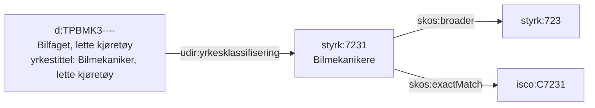

# Yrker: STYRK-08 og ISCO-08

Et programområde på Vg3 i yrkesfag ender i et yrke: Vg3 bilfaget, lette kjøretøy utdanner bilmekanikere for
lette kjøretøy. Grep har yrkestittelen som tekst (`u:yrkestittel`), og tekst kan ikke kobles til statistikk
eller til andre lands yrker. Sandkassen kobler derfor programområdene til **STYRK-08**, SSBs
yrkesklassifisering, og derfra til **ISCO-08**, den internasjonale standarden.

Se [oversikten](oversikt.md) for hvordan dette henger sammen med ESCO og NUS.

## Hva STYRK-08 er

STYRK-08 er SSBs standard for yrkesklassifisering, og brukes i arbeidsmarkedsstatistikken. Standarden har
fire nivåer, og koden blir ett siffer lengre for hvert nivå:

| Nivå | Siffer | Antall | Eksempel |
|---|---|---|---|
| Yrkesfelt (hovedgruppe) | 1 | 10 | `7` Håndverkere |
| Yrkesområde | 2 | 43 | `72` Metall- og maskinarbeidere |
| Yrkesgruppe | 3 | 122 | `723` Mekanikere og reparatører |
| Yrke | 4 | 407 | `7231` Bilmekanikere |

STYRK-08 er den norske utgaven av ISCO-08 fra Den internasjonale arbeidsorganisasjonen (ILO), og kodene er de
samme. Seks koder er norske tilpasninger som ISCO-08 ikke har.

## Slik ligger den i sandkassen

STYRK-08 er et SKOS-begrepssystem, `udir:Styrk08`, med alle 582 gruppene:

```turtle
styrk:7231 a skos:Concept ;
    skos:inScheme udir:Styrk08 ;
    skos:notation "7231" ;
    skos:prefLabel "Bilmekanikere"@nb ;
    skos:broader styrk:723 ;
    skos:exactMatch isco:C7231 ;
    rdfs:seeAlso <https://data.ssb.no/api/klass/v1/classifications/7/codesAt?date=2026-11-09&selectCodes=7231> .
```

| Egenskap | Innhold |
|---|---|
| `skos:notation` | STYRK-koden |
| `skos:prefLabel` | Navnet på bokmål, slik SSB har det |
| `skos:broader` | Gruppen på nivået over |
| `skos:exactMatch` | Samme gruppe i ISCO-08, med ESCOs adresse |
| `rdfs:seeAlso` | Koden i SSBs KLASS, der gruppen er beskrevet |

**Adressene er sandkassens egne.** SSB har ingen faste adresser for kodene. Sandkassen bruker
`http://psi.udir.no/ontologi/styrk08/` pluss koden, med prefikset `styrk:`. Kilden er SSBs KLASS,
klassifikasjon 7.

**Veien opp fra et yrke til yrkesfeltet:**

```sparql
SELECT ?kode ?navn WHERE {
  styrk:7231 skos:broader* ?g .
  ?g skos:notation ?kode ; skos:prefLabel ?navn .
} ORDER BY ?kode
```

`skos:broader*` følger hierarkiet oppover, og tar med utgangspunktet selv.

**Alle yrkene under en yrkesgruppe:**

```sparql
SELECT ?kode ?navn WHERE {
  ?g skos:broader styrk:723 ; skos:notation ?kode ; skos:prefLabel ?navn .
} ORDER BY ?kode
```

## Koblingen fra programområdene

Egenskapen `udir:yrkesklassifisering` går fra et programområde til yrket i STYRK-08, alltid på firesifret nivå:



**300 av 309** programområder med yrkestittel har en kobling. Utgåtte programområder er med, slik at de som
tok utdanningen tidligere, også kan plasseres.

| Metode | Antall | Betyr |
|---|---|---|
| `ssb-yrkeskatalog` | 194 | Yrkestittelen står i SSBs Yrkeskatalog med en STYRK-kode |
| `forslag` og `manuell` | 106 | Yrkestittelen står ikke i katalogen. Koden er vurdert manuelt i sandkassen, for 15 av dem med ESCO som støtte. |
| `ingen` | 9 | Bevisst uten kobling |

Metoden står i kilden, [styrk.csv](https://github.com/aremjolsnes/grep-jena-fuseki/blob/main/ontologi/koblinger/styrk.csv),
og er ikke med i grafen.

To regler er fulgt:

- **Aldri hovedgruppe 1 eller 2.** Ledere og akademiske yrker krever høyere utdanning. Noen programområder er
  uten kobling nettopp fordi den riktige gruppen ligger i hovedgruppe 2.
- **Én kode per programområde.** Ingen programområder har to yrker.

**Programområder som mangler kobling:**

```sparql
SELECT ?kode ?yrkestittel WHERE {
  ?p a u:Programomraade ; u:kode ?kode ; u:yrkestittel ?yrkestittel .
  FILTER(LANG(?yrkestittel) = "default")
  FILTER NOT EXISTS { ?p udir:yrkesklassifisering ?k }
} ORDER BY ?kode
```

Det er blant annet mediedesigner, droneoperatør og industrioppmåler. Forslagene som ble vurdert og avvist, står
i merknadsfeltet i `styrk.csv`.

## Spørringer

**Yrket til ett programområde:**

```sparql
SELECT ?yrkestittel ?styrk ?gruppe WHERE {
  d:TPBMK3---- u:yrkestittel ?yrkestittel ; udir:yrkesklassifisering ?k .
  FILTER(LANG(?yrkestittel) = "default")
  ?k skos:notation ?styrk ; skos:prefLabel ?gruppe .
}
```

**Motsatt vei: programområdene som utdanner til et yrke.** Flere programområder kan føre til samme STYRK-yrke:

```sparql
SELECT ?kode ?yrkestittel ?status WHERE {
  ?p udir:yrkesklassifisering styrk:7115 ; u:kode ?kode ; u:yrkestittel ?yrkestittel ; u:status ?s .
  FILTER(LANG(?yrkestittel) = "default")
  BIND(STRAFTER(STR(?s), "status_") AS ?status)
} ORDER BY ?kode
```

`styrk:7115` er Tømrere og snekkere. Listen har både publiserte og utgåtte programområder.

**Programområder per yrkesfelt.** Stien `skos:broader+` går fra yrket opp til hovedgruppen:

```sparql
SELECT ?hovedgruppe ?navn (COUNT(DISTINCT ?p) AS ?antall) WHERE {
  ?h skos:topConceptOf udir:Styrk08 ; skos:notation ?hovedgruppe ; skos:prefLabel ?navn .
  OPTIONAL { ?p udir:yrkesklassifisering/skos:broader+ ?h }
} GROUP BY ?hovedgruppe ?navn ORDER BY ?hovedgruppe
```

I november 2026 er 189 av 300 i hovedgruppe 7, Håndverkere. Hovedgruppe 0, 1 og 2 har ingen.

**Bare gjeldende programområder.** Legg til status når du vil ha dagens tilbud:

```sparql
SELECT ?styrk ?gruppe (COUNT(?p) AS ?antall) WHERE {
  ?p udir:yrkesklassifisering ?k ; u:status st:publisert .
  ?k skos:notation ?styrk ; skos:prefLabel ?gruppe .
} GROUP BY ?styrk ?gruppe ORDER BY DESC(?antall) LIMIT 10
```

## ISCO-08: broen til Europa

Hver STYRK-gruppe har `skos:exactMatch` til samme gruppe i ISCO-08. Adressene er ESCOs, for ESCO publiserer
ISCO-08 som en del av sin klassifikasjon: `isco:C7231` er `http://data.europa.eu/esco/isco/C7231`.

576 av de 582 gruppene har en slik kobling. De seks uten er norske tilpasninger:

```sparql
SELECT ?kode ?navn WHERE {
  ?g skos:inScheme udir:Styrk08 ; skos:notation ?kode ; skos:prefLabel ?navn .
  FILTER NOT EXISTS { ?g skos:exactMatch ?isco }
} ORDER BY ?kode
```

Ingen programområder er koblet til disse seks.

**ISCO-gruppene har ikke navn i sandkassen.** Bare adressene er med, som bindeledd til ESCO. Navnet henter du
fra STYRK-gruppen, som er samme gruppe:

```sparql
SELECT ?isco ?navn WHERE {
  d:TPBMK3---- udir:yrkesklassifisering ?k .
  ?k skos:exactMatch ?isco ; skos:prefLabel ?navn .
}
```

Fra ISCO-gruppen går veien videre til ESCOs yrker. Se [ESCO: yrker og ferdigheter](esco.md).

## Vedlikehold

`styrk.ttl` lages av `scripts/lag-styrk-ttl.py` fra `styrk.csv` og SSBs KLASS. Filen redigeres ikke for hånd.
Hver natt kontrolleres det om SSB har tatt ut en kode som er i bruk, og om Grep har fått et programområde med
yrkestittel som ikke står i `styrk.csv`. Begge deler meldes som avvik.

En ny kobling er en ny rad i `styrk.csv`:

```
programomraade,status,yrkestittel,styrk,metode,merknad
BAAMF3----,publisert,Anleggsmaskinfører,8342,ssb-yrkeskatalog,
```
