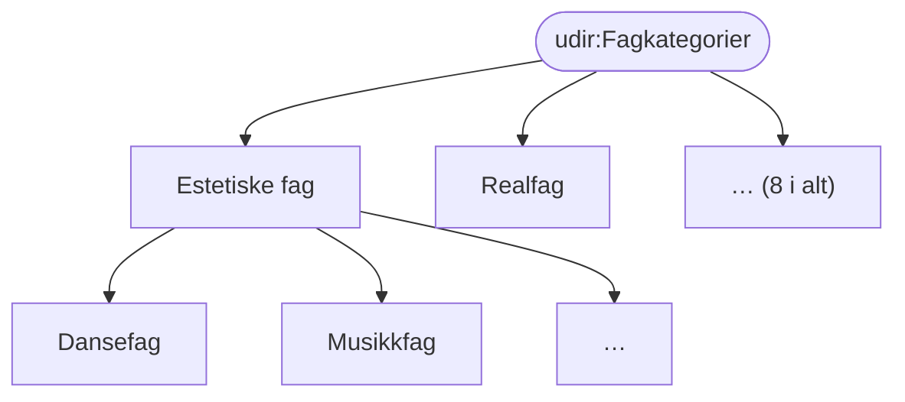

# Ontologien: begrepssystemer (SKOS)

Grep har flere små kodelister: fagtyper, opplæringsnivåer, fagkategorier, fagområder, språk og språknivåer. I
Grep er de vanlige ressurser med tittel og kode. I sandkassen er de også **SKOS-begreper**, ordnet i fem
begrepssystemer.

[SKOS](https://www.w3.org/TR/skos-reference/) er W3Cs standard for kodelister, klassifikasjoner og tesauruser.
Den gir faste navn på det slike lister har til felles: begrepet, navnet, koden og plassen i hierarkiet. Verktøy
som kjenner SKOS, kan da lese Grep-kodelistene uten å kjenne Grep. De koblede klassifikasjonene (STYRK-08, NUS,
ESCO) er også SKOS, så samme spørremønster virker overalt.

## De fem begrepssystemene

| Begrepssystem | Grep-klasse | Begreper | Brukes av |
|---|---|---|---|
| `udir:Fagtyper` | `u:Fagtype` | 10: fellesfag, valgfag, felles programfag … | `u:fagtype` på fagkoder, opplæringsfag og læreplaner |
| `udir:Opplaeringsnivaaer` | `u:Opplaeringsnivaa` | 3: grunnskole, videregående opplæring, forberedende opplæring for voksne | `u:opplaeringsnivaa` |
| `udir:Fagkategorier` | `u:Fagkategori`, `u:Fagomraade` | 59: 8 fagkategorier med 51 fagområder under | `u:fagomraade-referanser` på opplæringsfag |
| `udir:Spraak` | `u:Spraak` | 10: bokmål, nynorsk, engelsk, tre samiske språk, tysk, fransk, italiensk og spansk | `u:fastsatt-spraak` og `u:tilgjengelige-spraak` på læreplaner |
| `udir:Spraaknivaaer` | `u:Spraaknivaa` | 3: nivå I, II og III i fremmedspråk | `u:spraaknivaa` på fagkoder |

**Begrepssystemene, med antall begreper:**

```sparql
SELECT ?system ?navn (COUNT(?begrep) AS ?antall) WHERE {
  GRAPH <urn:graph:ontologi> { ?system a skos:ConceptScheme ; skos:prefLabel ?navn FILTER(LANG(?navn) = "nb") }
  ?begrep skos:inScheme ?system .
} GROUP BY ?system ?navn ORDER BY ?navn
```

`GRAPH` tar med bare Greps egne begrepssystemer. Uten den kommer STYRK-08, NUS og ISCED 2011 også med.

## Hva et begrep har

Begrepene er **Grep-ressursene selv**. `d:fagtype_valgfag` er både en fagtype i Grep og et begrep i
`udir:Fagtyper`. Det er ikke laget kopier med nye adresser.

| SKOS-egenskap | Innhold | Kommer fra |
|---|---|---|
| `a skos:Concept` | Ressursen er et begrep | klassen |
| `skos:inScheme` | Begrepssystemet | merket `udir:begrepssystem` på klassen |
| `skos:prefLabel` | Navnet, på hvert språk Grep har | `u:tittel` |
| `skos:notation` | Koden | `u:kode` |
| `skos:broader` / `skos:narrower` | Overbegrep og underbegrep | `u:fagkategori` på fagområdet |
| `skos:topConceptOf` | Begrepet er øverst i systemet | utledet |

Alt lages av regel R4, se [Utledning](utledning.md#r4-skos-begreper). Kommer det en ny fagtype i Grep, er den
et begrep neste natt.

**Språkkodene er gjort om.** Grep merker titler med `nob`, `nno`, `eng` og `sme`. SKOS-navnene har de vanlige
kodene `nb`, `nn`, `en` og `se`, slik andre vokabularer bruker dem. Tittelen med språket `default` er ikke med,
for den er en kopi av en av de andre.

**Alt om ett begrep:**

```sparql
SELECT ?egenskap ?verdi WHERE {
  GRAPH <urn:graph:utledet> { d:fagtype_valgfag ?egenskap ?verdi }
}
```

**Alle begrepene i et system**, med kode og navn på bokmål og nynorsk:

```sparql
SELECT ?kode ?bokmaal ?nynorsk WHERE {
  ?b skos:inScheme udir:Fagtyper ; skos:notation ?kode .
  OPTIONAL { ?b skos:prefLabel ?bokmaal FILTER(LANG(?bokmaal) = "nb") }
  OPTIONAL { ?b skos:prefLabel ?nynorsk FILTER(LANG(?nynorsk) = "nn") }
} ORDER BY ?kode
```

Bytt `udir:Fagtyper` med et av de andre systemene.

## Fagkategorier og fagområder

Dette er det eneste systemet med to nivåer. Fagkategoriene er toppbegreper, og hvert fagområde har én
fagkategori over seg:



**Hele hierarkiet:**

```sparql
SELECT ?kategori ?omraade WHERE {
  ?k skos:topConceptOf udir:Fagkategorier ; skos:prefLabel ?kategori ; skos:narrower ?o .
  ?o skos:prefLabel ?omraade .
  FILTER(LANG(?kategori) = "nb" && LANG(?omraade) = "nb")
} ORDER BY ?kategori ?omraade
```

Hierarkiet kommer fra Grep-egenskapen `u:fagkategori`, som ontologien sier er en `skos:broader`. Bare
fagområder har den, alle 51.

**Opplæringsfag per fagkategori.** Opplæringsfagene peker på fagområder. Går du ett steg opp med
`skos:broader`, får du kategorien:

```sparql
SELECT ?kategori (COUNT(DISTINCT ?fag) AS ?antall) WHERE {
  ?fag a u:Opplaeringsfag ; u:fagomraade-referanser/skos:broader ?k .
  ?k skos:prefLabel ?kategori FILTER(LANG(?kategori) = "nb")
} GROUP BY ?kategori ORDER BY DESC(?antall)
```

## Fagtyper og opplæringsnivåer

Fagtype og opplæringsnivå er to egne systemer uten hierarki. En fagtype er ikke et underbegrep av et
opplæringsnivå. At valgfag brukes i grunnskolen, står i Grep-dataene som `u:opplaeringsnivaa` på fagtypen, og
det er ikke gjort om til SKOS.

**Fagkoder per fagtype:**

```sparql
SELECT ?fagtype (COUNT(?fk) AS ?antall) WHERE {
  ?fk a u:Fagkode ; u:fagtype ?t .
  ?t skos:prefLabel ?fagtype FILTER(LANG(?fagtype) = "nb")
} GROUP BY ?fagtype ORDER BY DESC(?antall)
```

**Hvilke fagtyper hører til hvilket nivå?**

```sparql
SELECT ?nivaa ?fagtype WHERE {
  ?t skos:inScheme udir:Fagtyper ; skos:prefLabel ?fagtype ; u:opplaeringsnivaa ?n .
  ?n skos:prefLabel ?nivaa .
  FILTER(LANG(?fagtype) = "nb" && LANG(?nivaa) = "nb")
} ORDER BY ?nivaa ?fagtype
```

## Språk og EUs språktabell

Språkene i Grep er de samme som i
[EUs språktabell](http://publications.europa.eu/resource/authority/language), som bygger på ISO 639. Hvert språk
har derfor `skos:exactMatch` til EU-tabellen (regel R5):

```sparql
SELECT ?kode ?navn ?eu WHERE {
  ?s skos:inScheme udir:Spraak ; skos:notation ?kode ; skos:prefLabel ?navn ; skos:exactMatch ?eu .
  FILTER(LANG(?navn) = "nb")
} ORDER BY ?kode
```

`skos:exactMatch` betyr at de to begrepene kan brukes om hverandre. Det er den sterkeste av koblingene i SKOS,
se [relasjonene](../koblinger/oversikt.md#relasjonene) under Koblede kunnskapsgrafer. EU-tabellen selv ligger
ikke i sandkassen. Adressene er der, slik at Grep kan settes sammen med andre data som bruker EU-standarden,
for eksempel datasett på data.norge.no og data.europa.eu.

**Læreplaner per fastsettelsesspråk**, spurt med EU-adressen og Dublin Core:

```sparql
SELECT ?spraak (COUNT(?lp) AS ?antall) WHERE {
  ?lp a udir:Laereplan ; dcterms:language ?s .
  ?s skos:exactMatch ?eu ; skos:prefLabel ?spraak .
  FILTER(LANG(?spraak) = "nb")
} GROUP BY ?spraak ORDER BY DESC(?antall)
```

**Læreplaner som er tilgjengelige på nordsamisk:**

```sparql
SELECT ?kode WHERE {
  ?lp u:tilgjengelige-spraak/skos:exactMatch <http://publications.europa.eu/resource/authority/language/SME> ;
      u:kode ?kode .
} ORDER BY ?kode
```

## Språknivåer og CEFR

Nivå I, II og III i fremmedspråk svarer til nivåene A1, A2 og B1 i det europeiske rammeverket for språk (CEFR).
Grep har CEFR-nivået som tekst i `u:cefr`:

```sparql
SELECT ?kode ?navn ?cefr WHERE {
  ?n skos:inScheme udir:Spraaknivaaer ; skos:notation ?kode ; skos:prefLabel ?navn ; u:cefr ?cefr .
  FILTER(LANG(?navn) = "nb")
} ORDER BY ?kode
```

CEFR-nivåene er ikke koblet videre. CEFR har ikke noe offisielt vokabular med faste adresser ennå, og
sandkassen lager ikke egne begreper for noe som hører til Europarådet. Koblingen kan legges til når et
offisielt vokabular finnes.

## Hvorfor ikke alle kodelistene?

Grep har flere kodelister enn disse, for eksempel eksamensformer, trekkordninger og vurderingsuttrykk. De er
ikke gjort om til SKOS ennå. `udir:`-laget bygges stegvis, og hvert steg avklares med fagansvarlig. En ny
kodeliste krever bare et nytt begrepssystem og ett merke i `ontologi/udir.ttl`:

```turtle
udir:Eksamensformer a skos:ConceptScheme ; skos:prefLabel "Eksamensformer"@nb .
u:Eksamensform udir:begrepssystem udir:Eksamensformer .
```

Regel R4 gjør resten neste natt.
