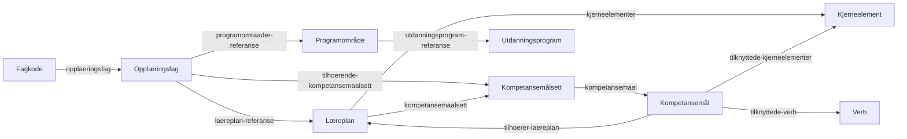
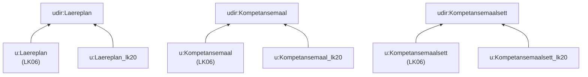
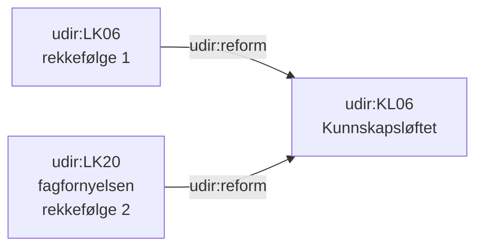

# Ontologien: klasser og egenskaper

Ontologien har 50 klasser og 172 egenskaper. Denne siden gir oversikten og forklarer hvordan du leser dem.
Tallene er fra november 2026. Spørringene gir tallene slik de er i dag.

Se [Hva ontologien er](oversikt.md) for bakgrunnen, og
[Bruke ontologien i spørringer](sporringer.md) for oppskrifter.

## Klassene

44 klasser kommer fra Grep-ontologien (`u:`), og seks fra `udir:`-laget. Alle Grep-klassene har ressurser i
dataene.

**Alle klassene, med navn og antall ressurser:**

```sparql
SELECT ?klasse ?navn (COUNT(DISTINCT ?s) AS ?antall) WHERE {
  GRAPH <urn:graph:ontologi> {
    ?klasse a owl:Class ; rdfs:label ?navn .
    FILTER(isIRI(?klasse) && LANG(?navn) = "nb")
  }
  OPTIONAL { ?s a ?klasse }
} GROUP BY ?klasse ?navn ORDER BY DESC(?antall)
```

`isIRI` tar bort de navnløse klassene som står inne i domener og rekkevidder (se «Domene og rekkevidde» under).

### Læreplanen og innholdet i den

| Klasse | Hva | Antall |
|---|---|---|
| `u:Laereplan` | Læreplan i LK06 | 594 |
| `u:Laereplan_lk20` | Læreplan i LK20 | 515 |
| `u:Kompetansemaalsett` | Kompetansemålsett i LK06: målene for et trinn eller et programfag | 1 320 |
| `u:Kompetansemaalsett_lk20` | Kompetansemålsett i LK20 | 1 197 |
| `u:Kompetansemaal` | Kompetansemål i LK06 | 17 021 |
| `u:Kompetansemaal_lk20` | Kompetansemål i LK20 | 15 189 |
| `u:Hovedomraade` | Hovedområde: inndelingen av innholdet i en LK06-læreplan | 1 485 |
| `u:Programfag` | Programfag: inndelingen i LK06-læreplaner som har programfag i stedet for hovedområder | 454 |
| `u:Kjerneelement_lk20` | Kjerneelement: det viktigste innholdet i faget (LK20) | 1 890 |
| `u:Tverrfaglig_tema_lk20` | De tre tverrfaglige temaene (LK20) | 3 |
| `u:Grunnleggende_ferdighet_lk20` | De fem grunnleggende ferdighetene (LK20) | 5 |
| `u:Verb_lk20` | Verb i kompetansemålene, med Udirs forklaring (LK20) | 94 |
| `u:Ordforklaring_lk20` | Forklaring av ord i en læreplan (LK20) | 29 |
| `u:Laereplanstruktur` | Om læreplanen er vanlig eller modulstrukturert | 2 |

### Fag og fagkoder

| Klasse | Hva | Antall |
|---|---|---|
| `u:Fagkode` | Fagkode: det som står på vitnemål og kompetansebevis | 6 620 |
| `u:Opplaeringsfag` | Opplæringsfag: faget det gis opplæring i, bindeleddet mellom fagkode og læreplan | 2 319 |
| `u:Fagtype` | Fellesfag, valgfag, felles programfag … | 10 |
| `u:Fagkategori` | Fagkategori, for eksempel Estetiske fag | 8 |
| `u:Fagomraade` | Fagområde under en fagkategori, for eksempel Dansefag | 51 |
| `u:Merkelapp` | Merkelapp på fagkoder, læreplaner, opplæringsfag og programområder | 21 |
| `u:Tidligere_navn` | Tidligere navn på et utdanningsprogram, et programområde eller en merknad, med perioden navnet gjaldt | 15 |

### Tilbudsstrukturen

| Klasse | Hva | Antall |
|---|---|---|
| `u:Utdanningsprogram` | Utdanningsprogram i videregående opplæring | 18 |
| `u:Utdanningsprogramtype` | Studieforberedende eller yrkesfaglig | 2 |
| `u:Programomraade` | Programområde: et trinn i et utdanningsprogram, for eksempel Vg3 bilfaget, lette kjøretøy | 497 |
| `u:Programomraadetype` | Skole, bedrift eller særløp | 3 |
| `u:Loepstype` | Løpstype (i dag bare kryssløp) | 1 |
| `u:Sluttkompetanse` | Studiekompetanse, yrkeskompetanse, fagbrev eller svennebrev | 4 |
| `u:Opplaeringssted` | Skole eller bedrift | 2 |
| `u:Opplaeringsnivaa` | Grunnskole, videregående opplæring, forberedende opplæring for voksne | 3 |
| `u:Aarstrinn` | Årstrinn | 18 |
| `u:Semester` | Semester, for eksempel høsten 2021 | 49 |

### Vurdering og dokumentasjon

| Klasse | Hva | Antall |
|---|---|---|
| `u:Eksamensordning` | Eksamensordningen for elever og privatister | 29 |
| `u:Eksamensform` | Skriftlig, muntlig, praktisk, fagprøve, svenneprøve … | 8 |
| `u:Oppgave` | Om eksamen er sentralt eller lokalt gitt | 2 |
| `u:Sensur` | Om sensuren er sentral eller lokal | 2 |
| `u:Trekkordning` | Obligatorisk eksamen, trekkfag, bare særskilt eksamen eller ingen eksamen | 4 |
| `u:Vurderingsuttrykk` | Tallkarakter, bestått/ikke bestått, deltatt … | 8 |
| `u:Karakter` | Lovlige karakteruttrykk i dokumentasjon, for eksempel «FEM» og «BESTÅTT» | 20 |
| `u:Merknad` | Fag- og vitnemålsmerknader | 108 |
| `u:Merknadstype` | Fagmerknad eller vitnemålsmerknad | 2 |
| `u:Dokumenttype` | Vitnemål eller kompetansebevis | 2 |

### Felles

| Klasse | Hva | Antall |
|---|---|---|
| `u:Spraak` | Språkene Grep-innholdet finnes på | 10 |
| `u:Spraaknivaa` | Nivå I, II og III i fremmedspråk | 3 |
| `u:Status` | Publisert, utgått, under arbeid, til revidering og ugyldig | 5 |

Statusverdiene i dataene peker til REST-API-adresser og ikke til ressursene av typen `u:Status`. Se «Egenheter
i dataene» i [brukerveiledningen](../bruk.md#egenheter-i-dataene).

### Klassene i udir:-laget

| Klasse | Hva | Antall |
|---|---|---|
| `udir:Laereplan` | Læreplan uavhengig av revisjon | 1 109 |
| `udir:Kompetansemaal` | Kompetansemål uavhengig av revisjon | 32 210 |
| `udir:Kompetansemaalsett` | Kompetansemålsett uavhengig av revisjon | 2 517 |
| `udir:Reform` | En utdanningsreform | 1 |
| `udir:Revisjon` | En revisjon av en reform, med eget læreplanverk | 2 |
| `udir:Gyldighet` | Gyldighetsperioden for én kobling mellom to ressurser | 36 210 |

## Slik henger hovedklassene sammen

Diagrammet viser de viktigste relasjonene i LK20. Pilene er egenskaper i `u:`.



Fagkoden er inngangen for de fleste som kommer fra et skoleadministrativt system. Derfra går veien via
opplæringsfaget til læreplanen og kompetansemålsettet, og videre til målene. Mange av relasjonene finnes i
begge retninger, for eksempel `u:kompetansemaal` fra settet til målet og `u:tilhoerer-kompetansemaalsett`
tilbake.

Koblingene fra fagkode til opplæringsfag og fra opplæringsfag til læreplan og kompetansemålsett har
gyldighetsperioder. Skal du ha det som gjaldt på en bestemt dato, går du via `udir:gyldighet`. Se
«Læreplanutsnitt for AI» i [brukerveiledningen](../bruk.md#læreplanutsnitt-for-ai).

## Overbegreper

Læreplan, kompetansemål og kompetansemålsett finnes i én utgave for LK06 og én for LK20. Fagansvarlig har
avklart at det er samme begrep i hver sin utgave, og `udir:`-laget har derfor et overbegrep for hver:



Pilene er `rdfs:subClassOf`. Hver læreplan har derfor tre typer i sandkassen: typen fra dataene
(`u:laereplan_lk20`), klassen (`u:Laereplan_lk20`) og overbegrepet (`udir:Laereplan`).

**Hovedområde og kjerneelement har ikke noe overbegrep.** De har en lignende plass i læreplanen, men er ulike
begreper, og en kobling mellom dem ville vært en redaksjonell jobb. Ontologien sier dette uttrykkelig:
`u:Hovedomraade owl:disjointWith u:Kjerneelement_lk20`, og de to peker til hverandre med `rdfs:seeAlso`.

## Reform og revisjon



Kunnskapsløftet er reformen. LK06 og LK20 er revisjonene av den. De samiske læreplanverkene er varianter
innenfor hver revisjon og ikke egne revisjoner.

Hver klasse som hører til én revisjon, er merket med `udir:gjelderRevisjon`:

| Revisjon | Klasser |
|---|---|
| `udir:LK06` | `u:Laereplan`, `u:Kompetansemaal`, `u:Kompetansemaalsett`, `u:Hovedomraade`, `u:Programfag` |
| `udir:LK20` | `u:Laereplan_lk20`, `u:Kompetansemaal_lk20`, `u:Kompetansemaalsett_lk20`, `u:Kjerneelement_lk20`, `u:Tverrfaglig_tema_lk20`, `u:Grunnleggende_ferdighet_lk20`, `u:Ordforklaring_lk20`, `u:Verb_lk20` |

Hver ressurs av disse klassene får `udir:revisjon` (regel R3). Fagkoder, opplæringsfag, programområder og andre
ressurser som gjelder begge revisjonene, har ingen revisjon.

## Egenskapene

| Slag | Antall | Verdien er |
|---|---|---|
| Objektegenskap (`owl:ObjectProperty`) | 89 | en annen ressurs |
| Dataegenskap (`owl:DatatypeProperty`) | 83 | tekst, tall, dato eller ja/nei |

**Alle egenskapene, med navn, forklaring og hvor mye de brukes:**

```sparql
SELECT ?egenskap ?navn ?forklaring (COUNT(?s) AS ?brukt) WHERE {
  GRAPH <urn:graph:ontologi> {
    ?egenskap a ?slag ; rdfs:label ?navn .
    VALUES ?slag { owl:ObjectProperty owl:DatatypeProperty }
    FILTER(LANG(?navn) = "nb")
    OPTIONAL { ?egenskap rdfs:comment ?forklaring FILTER(LANG(?forklaring) = "nb") }
  }
  OPTIONAL { ?s ?egenskap ?o }
} GROUP BY ?egenskap ?navn ?forklaring ORDER BY DESC(?brukt)
```

### Generelle egenskaper

Disse brukes på nesten alle typer og har ikke noe domene:

| Egenskap | Innhold |
|---|---|
| `u:kode` | Koden, for eksempel `NOR01-07` eller `KM8644` |
| `u:tittel` | Tittelen på flere språk. For et kompetansemål er tittelen selve målteksten. |
| `u:kortform` | Kort navn |
| `u:beskrivelse` | Beskrivelse, ofte som HTML: teksten i et kjerneelement eller hovedområde, forklaringen av et verb |
| `u:status` | Publisert eller utgått |
| `u:sist-endret` | Når posten sist ble endret i Grep |
| `u:gyldig-fra`, `u:gyldig-til` | Redaksjonelle gyldighetsdatoer |
| `u:rekkefoelge` | Plassen i en rekkefølge |
| `u:id`, `u:uri`, `u:url-data`, `u:grep-type` | Identifikatorer: Greps interne id, PSI-adressen, adressen i REST-API-et og typen |

`udir:`-egenskapene for gyldighet, perioder og titler (`udir:gyldighet`, `udir:gyldigFra`, `udir:eksamenFra`,
`udir:bokmaalTittel` …) har heller ikke domene, fordi de brukes på mange typer.

### Domene og rekkevidde

De andre egenskapene har **domene** (`rdfs:domain`): hva slags ressurs egenskapen står på. 166 av 172 har
**rekkevidde** (`rdfs:range`): hva slags verdi den har.

```turtle
u:benyttes-sammen-med rdfs:domain u:Fagkode ;   # står på en fagkode
                      rdfs:range  u:Fagkode .   # og peker på en annen fagkode
```

Når flere klasser er mulige, står de i en **union**, en navnløs klasse som betyr «en av disse»:

```turtle
u:bygger-paa rdfs:range [ a owl:Class ;
    owl:unionOf ( u:Kompetansemaal_lk20 u:Kompetansemaalsett_lk20 ) ] .
```

Unionen er en RDF-liste, og du går gjennom den med stien `owl:unionOf/rdf:rest*/rdf:first`. Legger du til et
spørsmålstegn, dekker samme mønster både en enkelt klasse og en union:

```sparql
SELECT ?egenskap ?navn WHERE {
  GRAPH <urn:graph:ontologi> {
    ?egenskap rdfs:domain ?d ; rdfs:label ?navn .
    ?d (owl:unionOf/rdf:rest*/rdf:first)? u:Kompetansemaal_lk20 .
    FILTER(LANG(?navn) = "nb")
  }
} ORDER BY ?egenskap
```

Dette er egenskapene et LK20-kompetansemål kan ha, i tillegg til de generelle.

Tre ting å vite når du leser domene og rekkevidde:

- **De følger dataene.** Domenet og rekkevidden sier hvilke klasser egenskapen faktisk brukes på og peker på. Se
  [Hvordan den er bygd](oversikt.md#hvordan-den-er-bygd).
- **Unionene hører ikke sammen parvis.** `u:erstatter` har både domene og rekkevidde «fagkode, opplæringsfag,
  læreplan, programområde eller utdanningsprogram». Det betyr ikke at en fagkode kan erstatte et programområde.
  I dataene erstatter en fagkode en fagkode, og et opplæringsfag et opplæringsfag. Det eneste krysset er
  LK20-læreplaner som erstatter LK06-læreplaner.
- **Ingenting utledes av dem.** At `u:benyttes-sammen-med` har domenet `u:Fagkode`, gjør ikke en ressurs med
  den egenskapen til en fagkode i sandkassen. Typene kommer fra dataene og fra underklassene. Domene og
  rekkevidde er dokumentasjon og noe du kan kontrollere dataene mot.

### Egenskaper med ekstra merker

- **Irrefleksive** (`owl:IrreflexiveProperty`, 9 egenskaper): en ressurs kan ikke ha relasjonen til seg selv.
  Det gjelder `u:erstatter`, `u:erstattes-av`, `u:bygger-paa`, `u:bygger-paa-fag`, `u:bygger-paa-programomraade`,
  `u:benyttes-sammen-med`, `u:gjenbruk-av`, `u:loepstype-kryssloep` og
  `u:fortsetter-opplaering-i-samme-kompetansemaalsett-som`.
- **Funksjonelle** (`owl:FunctionalProperty`, 6 egenskaper i `udir:`): høyst én verdi. Det gjelder
  `udir:reform`, `udir:rekkefoelge`, `udir:relasjon`, `udir:objekt`, `udir:startdato` og `udir:sluttdato`.
- **Underegenskaper** (`rdfs:subPropertyOf`, 8 egenskaper): egenskapen er en spesialisering av en egenskap i et
  kjent vokabular. Se [R2 under Utledning](utledning.md#r2-egenskaper-via-underegenskaper).

Ingen av merkene håndheves. En spørring som finner brudd på irrefleksivitet, står under
[Bruke ontologien i spørringer](sporringer.md#kontrollere-dataene-mot-ontologien).

### Navn som er både type og egenskap

Mange navn med liten forbokstav er begge deler. Da avgjør plassen i trippelet hva som menes:

```sparql
SELECT ?sett ?maal WHERE {
  ?sett a u:kompetansemaalsett_lk20 ;      # type: står etter «a»
        u:tilhoerer-laereplan d:NOR01-07 ;
        u:kompetansemaal ?maal .           # egenskap: står mellom to ressurser
} LIMIT 10
```

Det er grunnen til at klassene i ontologien har stor forbokstav. Se
[Typekoblingen](oversikt.md#typekoblingen-stor-og-liten-forbokstav).

## Navn og språk

Alle klasser og egenskaper har navn (`rdfs:label`) og forklaring (`rdfs:comment`).

| Lag | Språk |
|---|---|
| Grep-ontologien (`u:`) | Bokmål (`nb`) og engelsk (`en`) |
| `udir:`-laget | Bokmål (`nb`), nynorsk (`nn`) og engelsk (`en`) |

Navnene på klassene og egenskapene i Grep-ontologien er skrevet ut fra dataene og Udirs eget språk i Grep.
Finner du en skrivefeil eller en feiloversettelse, rettes den direkte i `ontologi/grep.ttl`.
