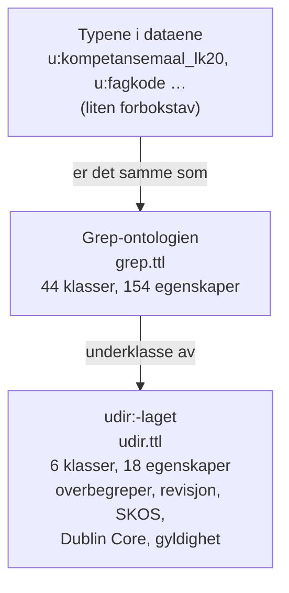

# Ontologien: hva den er

Grep-dataene sier *hva som finnes*: denne læreplanen, dette kompetansemålet, denne fagkoden. Ontologien sier
*hva slags ting det er*, og hvordan de henger sammen: hva en læreplan er, hvilke egenskaper den kan ha, og hva
egenskapene peker på. Dataene og ontologien ligger i samme endepunkt, og begge kan spørres med SPARQL.

Denne siden forklarer hva ontologien består av og hvor den kommer fra. De andre sidene går i dybden:

| Side | Innhold |
|---|---|
| **Hva den er** (denne siden) | De to delene av ontologien, navnene, hvor den kommer fra og hvordan den er bygd |
| [Klasser og egenskaper](klasser-og-egenskaper.md) | De 50 klassene og 172 egenskapene, og hvordan du leser domene og rekkevidde |
| [Bruke ontologien i spørringer](sporringer.md) | Oppskrifter: slå opp, få lesbare navn, spørre på tvers av revisjoner, kontrollere dataene |
| [Utledning (R1–R5)](utledning.md) | Reglene som hver natt gjør ontologien om til tripler du kan spørre på |
| [Begrepssystemer (SKOS)](begrepssystemer.md) | Fagtyper, opplæringsnivåer, fagkategorier, språk og språknivåer som SKOS-begreper |

Koblingene ut av Grep, til STYRK-08, ESCO, NUS og ISCED, står under
[Koblede kunnskapsgrafer](../koblinger/oversikt.md).

## To deler

Ontologien ligger i grafen `urn:graph:ontologi` og er satt sammen av to filer:



| Del | Fil | Navnerom | Innhold |
|---|---|---|---|
| Grep-ontologien | `ontologi/grep.ttl` | `u:` | Klassene og egenskapene i Grep slik de brukes i dataene, og koblingen mellom klassen og typen i dataene |
| `udir:`-laget | `ontologi/udir.ttl` | `udir:` | Sandkassens forslag til begreper som ikke hører til én revisjon |

Til sammen er det 2 063 tripler: 50 klasser, 89 objektegenskaper, 83 dataegenskaper og 5 begrepssystemer.

Navnerommene er `u:` = `http://psi.udir.no/ontologi/kl06/` og `udir:` = `http://psi.udir.no/ontologi/`.
Grep-ressursene selv ligger i `d:` = `http://psi.udir.no/kl06/`.

## Grep-ontologien

Grep-ontologien beskriver typene og egenskapene i Grep som OWL. Hver klasse og egenskap har navn
(`rdfs:label`) og forklaring (`rdfs:comment`) på bokmål og engelsk, og egenskapene har domene og rekkevidde.

Et eksempel, slik det står i filen:

```turtle
u:benyttes-paa-aarstrinn a owl:ObjectProperty ;
    rdfs:label "taught in year levels"@en, "benyttes på årstrinn"@nb ;
    rdfs:comment "Egenskap for kompetansemålsett for å angi hvilke(t) årstrinn det benyttes på"@nb ;
    rdfs:domain [ a owl:Class ;
            owl:unionOf ( u:Kompetansemaalsett u:Kompetansemaalsett_lk20 ) ] ;
    rdfs:range u:Aarstrinn .
```

Det leses slik: `u:benyttes-paa-aarstrinn` er en relasjon fra et kompetansemålsett (LK06 eller LK20) til et
årstrinn.

### Hvordan den er bygd

Ontologien beskriver Grep-dataene slik de er. Utgangspunktet var et eksperimentelt utkast fra Grep-teamet i
Udir, «OWL for Grep (utkast)» fra mai 2024. `ontologi/grep.ttl` er ontologien slik den gjelder i dag, og den
vedlikeholdes for hånd. Den er sandkassens **forslag**, laget stegvis i dialog med fagansvarlig for Grep, og
ikke noe Udir har vedtatt. Prinsippene:

- **Ontologien og dataene har de samme egenskapene.** Hver `u:`-egenskap i dataene står i ontologien, og hver
  egenskap i ontologien brukes i dataene. Adressene er de samme, for eksempel `u:laereplanstruktur`. Det eneste
  unntaket er de genererte `u:gyldighet-…`-egenskapene, som sandkassen gjør om til `udir:Gyldighet` (se «Egenheter
  i dataene» i [brukerveiledningen](../bruk.md#egenheter-i-dataene)).
- **Flere mulige klasser står som en union.** Står det to `rdfs:domain` på en egenskap, betyr det i RDFS og OWL at
  ressursen er *begge* deler. Ontologien bruker derfor `owl:unionOf` («en av disse») når en egenskap kan stå på
  flere klasser.
- **Generelle egenskaper har ikke domene.** `u:tittel`, `u:kode`, `u:beskrivelse`, `u:status` og noen få andre
  brukes på mer enn ti typer. Da sier et domene ingenting.
- **Egenskapstypen og rekkevidden følger dataene.** `u:uri` er en objektegenskap fordi verdiene er ressurser.
  `u:bygger-paa` har rekkevidden «kompetansemål eller kompetansemålsett» fordi den peker på begge deler.
- **Datatypene er de riktige, ikke de i dumpen.** Datoer er `xsd:dateTime`, timetall er `xsd:integer` og
  opplæringstid er `xsd:decimal`. I dumpen er de tekst, og sandkassen gjør dem om hver natt etter rekkevidden i
  ontologien (se «Normaliserte data» i [brukerveiledningen](../bruk.md#normaliserte-data)).
- **Navnene og forklaringene skal være riktige.** Skrivefeil og feiloversettelser rettes i filen når de blir
  oppdaget.

En endring i dataene, for eksempel en ny egenskap eller en ny type i Grep, gjør at ontologien må oppdateres. Den
nattlige innlastingen sjekker dette og melder det i issuen «Avvik i Grep-dataene» i repoet. Den melder egenskaper
som mangler i ontologien, typer som ikke er koblet til en klasse, og koblinger uten motpart for egenskaper merket
som motsatte. Spørringene står under
[Bruke ontologien i spørringer](sporringer.md#kontrollere-dataene-mot-ontologien).

## Typekoblingen: stor og liten forbokstav

Klassene i ontologien har **stor** forbokstav (`u:Kompetansemaal_lk20`). Typene i dataene har **liten**
(`u:kompetansemaal_lk20`). Det er to ulike adresser.

Grunnen er at mange av navnene med liten forbokstav også er egenskaper. `u:kompetansemaalsett` er både typen
til et kompetansemålsett og egenskapen som peker fra en læreplan til settene. I OWL kan ikke samme adresse være
både klasse og egenskap uten at verktøy snubler, og ontologien har derfor egne adresser for klassene.

`grep.ttl` kobler de 44 parene, rett etter hver klasse:

```turtle
u:Kompetansemaal_lk20 owl:equivalentClass u:kompetansemaal_lk20 ;
    rdfs:subClassOf u:kompetansemaal_lk20 .
u:kompetansemaal_lk20 rdfs:subClassOf u:Kompetansemaal_lk20 .
```

`owl:equivalentClass` sier at de to er samme klasse. `rdfs:subClassOf` begge veier sier det samme på en måte
som også enkle RDFS-verktøy forstår. Koblingen gjelder bare bruken som type. Bruken som egenskap er uberørt.

I praksis kan du bruke hvilken du vil i sandkassen:

```sparql
SELECT ?type (COUNT(?s) AS ?antall) WHERE {
  VALUES ?type { u:kompetansemaal_lk20 u:Kompetansemaal_lk20 }
  ?s a ?type
} GROUP BY ?type
```

Begge gir 15 189. Hos Udir gir bare den med liten forbokstav treff.

## udir:-laget

Grep-ontologien beskriver Grep slik det er, revisjon for revisjon. `udir:`-laget legger til begreper som går på
tvers. Det er sandkassens **forslag**, laget stegvis i dialog med fagansvarlig for Grep, og ikke noe Udir har
vedtatt.

| Hva | Eksempel | Les mer |
|---|---|---|
| Overbegreper på tvers av LK06 og LK20 | `udir:Laereplan`, `udir:Kompetansemaal`, `udir:Kompetansemaalsett` | [Klasser og egenskaper](klasser-og-egenskaper.md#overbegreper) |
| Reform og revisjon | `udir:KL06`, `udir:LK06`, `udir:LK20`, `udir:revisjon` | [Klasser og egenskaper](klasser-og-egenskaper.md#reform-og-revisjon) |
| SKOS-begrepssystemer | `udir:Fagtyper`, `udir:Fagkategorier`, `udir:Spraak` | [Begrepssystemer](begrepssystemer.md) |
| Kjente vokabularer | `u:erstatter` er en `dcterms:replaces` | [Utledning](utledning.md#r2-egenskaper-via-underegenskaper) |
| Gyldighet og perioder | `udir:Gyldighet`, `udir:gyldigFra`, `udir:eksamenTil` | [Brukerveiledningen](../bruk.md#normaliserte-data) |
| Tittel per målform | `udir:bokmaalTittel`, `udir:nynorskTittel` | [Brukerveiledningen](../bruk.md#normaliserte-data) |
| Koblinger ut av Grep | `udir:yrkesklassifisering`, `udir:utdanningsklassifisering` | [Koblede kunnskapsgrafer](../koblinger/oversikt.md) |

Regelen er at `udir:` bare brukes der det tilfører noe. Klasser som allerede gjelder begge revisjonene, som
`u:Fagkode` og `u:Opplaeringsfag`, får ingen `udir:`-utgave.

## Ontologien virker uten resonnerer

En ontologi gir vanligvis nye svar først når en *resonnerer* leser den og trekker slutninger. Sandkassen kjører
ingen resonnerer. I stedet regnes slutningene ut på forhånd hver natt, med fem SPARQL-regler, og lagres som
vanlige tripler i `urn:graph:utledet` (omtrent 270 000 tripler).

Det betyr tre ting:

- **Spørringene er vanlige spørringer.** `?s a udir:Laereplan` slår opp tripler som finnes, og går like raskt
  som andre oppslag.
- **Bare det reglene dekker, er utledet.** Reglene følger `rdfs:subClassOf` og `rdfs:subPropertyOf`, og noen
  egne merker i `udir:`-laget. Domene, rekkevidde, `owl:disjointWith`, `owl:IrreflexiveProperty` og `owl:inverseOf`
  står i ontologien som dokumentasjon, og ingenting utledes av dem.
- **Det gjelder bare her.** Udirs endepunkt har ikke ontologien, og `?s a u:Kompetansemaal` gir ingen treff
  der.

Reglene står forklart under [Utledning (R1–R5)](utledning.md).

## Hvor den ligger, og hvordan den endres

| | |
|---|---|
| **Graf** | `urn:graph:ontologi` |
| **Kilde** | [ontologi/](https://github.com/aremjolsnes/grep-jena-fuseki/tree/main/ontologi) i repoet |
| **Lastes inn** | Ved hver innlasting, og når en fil under `ontologi/` endres i repoet |
| **Laste ned** | Spørringen under, eller filene i repoet |

Hele ontologien som Turtle:

```sparql
CONSTRUCT { ?s ?p ?o } WHERE { GRAPH <urn:graph:ontologi> { ?s ?p ?o } }
```

En endring i ontologien er en endring i en fil i repoet. Etter innlastingen kjøres utledningsreglene på nytt,
så en ny `rdfs:subClassOf` gir nye typer i `urn:graph:utledet` uten at reglene må endres.
