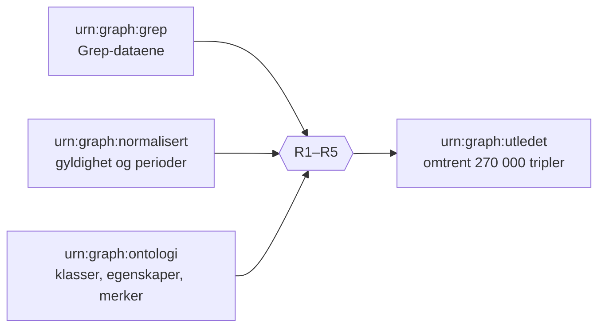
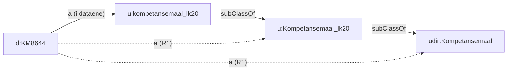

# Ontologien: utledning (R1–R5)

En ontologi sier for eksempel at alle LK20-læreplaner er læreplaner. For at `?s a udir:Laereplan` skal gi treff,
må noen trekke slutningen. Vanligvis gjør en resonnerer det mens spørringen kjøres. Sandkassen gjør det på
forhånd: hver natt regner fem regler ut slutningene og lagrer dem som vanlige tripler i `urn:graph:utledet`.

Denne siden forklarer hva hver regel gjør, og hva som bevisst ikke utledes. Du trenger ikke å kunne reglene for
å bruke resultatet. Se [Bruke ontologien i spørringer](sporringer.md) for det.

## Oversikt



| Regel | Leser i ontologien | Gir | Tripler |
|---|---|---|---|
| [R1](#r1-typer-via-underklasser) | `rdfs:subClassOf` | Typene med stor forbokstav og overbegrepene | 85 500 |
| [R2](#r2-egenskaper-via-underegenskaper) | `rdfs:subPropertyOf` | Dublin Core, schema.org og `skos:broader` | 144 200 |
| [R3](#r3-revisjon) | `udir:gjelderRevisjon` | `udir:revisjon` på hver ressurs | 39 800 |
| [R4](#r4-skos-begreper) | `udir:begrepssystem` | SKOS-begreper av kodelistene | 600 |
| [R5](#r5-språk) | (ingen, bruker språkkoden) | `skos:exactMatch` til EUs språktabell | 10 |

Reglene er SPARQL Update-filer i
[sparql/utledning/](https://github.com/aremjolsnes/grep-jena-fuseki/tree/main/sparql/utledning) og kjøres i
alfabetisk rekkefølge. Grafen tømmes først, så det utledede er alltid regnet ut fra nattens data og
ontologi.

Hva som ligger i grafen nå, per egenskap:

```sparql
SELECT ?egenskap (COUNT(*) AS ?antall) WHERE {
  GRAPH <urn:graph:utledet> { ?s ?egenskap ?o }
} GROUP BY ?egenskap ORDER BY DESC(?antall)
```

## R1: Typer via underklasser

> Har en ressurs typen C, og C er en underklasse av D, får ressursen også typen D.

Regelen følger `rdfs:subClassOf` i alle ledd. Den gir to ting:

- **Klassene med stor forbokstav.** Typekoblingen sier at `u:kompetansemaal_lk20` er en underklasse av
  `u:Kompetansemaal_lk20`. Hvert LK20-kompetansemål får derfor også typen med stor forbokstav.
- **Overbegrepene.** `u:Kompetansemaal_lk20` er en underklasse av `udir:Kompetansemaal`, så målet får den typen
  også.



Kjernen i regelen:

```sparql
# ikke test
INSERT { GRAPH <urn:graph:utledet> { ?s a ?d } }
WHERE {
  GRAPH <urn:graph:grep>     { ?s a ?c }
  GRAPH <urn:graph:ontologi> { ?c rdfs:subClassOf+ ?d }
}
```

Regelen leser typer både fra Grep-dataene og fra de normaliserte dataene, og skriver ikke typer som allerede
står der. En ny `rdfs:subClassOf` i ontologien gir nye typer neste natt, uten at regelen endres.

## R2: Egenskaper via underegenskaper

> Har en ressurs egenskapen P med en verdi, og P er en underegenskap av Q, får ressursen også Q med samme verdi.

Ontologien har åtte underegenskaper, alle til kjente vokabularer:

| Egenskap | Er en | Tripler |
|---|---|---|
| `udir:gyldigFra` | `schema:validFrom` | 44 550 |
| `udir:gyldigTil` | `schema:validThrough` | 44 550 |
| `u:tilhoerer-laereplan` | `dcterms:isPartOf` | 44 079 |
| `u:erstatter` | `dcterms:replaces` | 4 410 |
| `u:erstattes-av` | `dcterms:isReplacedBy` | 4 410 |
| `u:fastsatt-spraak` | `dcterms:language` | 1 109 |
| `u:fastsatt-dato` | `dcterms:dateAccepted` | 1 031 |
| `u:fagkategori` | `skos:broader` | 51 |

Tre valg er verdt å kjenne:

- **`u:fastsatt-dato` er `dcterms:dateAccepted`**, datoen planen ble vedtatt, og ikke `dcterms:issued`.
- **`u:tilgjengelige-spraak` er ikke koblet.** Den omfatter alle språkene planen finnes på, også det
  fastsatte, og er noe annet enn `dcterms:language`.
- **Bare gyldighet er koblet til schema.org.** Undervisning og eksamen har egne perioder. Ble de også til
  `schema:validFrom`, kunne ikke schema.org skille mellom de tre.

Tittel, kode, beskrivelse og sist endret har ingen Dublin Core-utgave ennå. Det ville gitt omtrent 250 000
tripler, og venter til noen trenger dem.

## R3: Revisjon

> Er en ressurs av en klasse som er merket med en revisjon, får ressursen `udir:revisjon` til den revisjonen.

Merket er `udir:gjelderRevisjon` og står på klassen i `udir.ttl`:

```turtle
u:Kompetansemaal_lk20 udir:gjelderRevisjon udir:LK20 .
```

Regelen gir da hvert LK20-kompetansemål `udir:revisjon udir:LK20`. Fem klasser er merket med LK06 og åtte med
LK20. Se [Reform og revisjon](klasser-og-egenskaper.md#reform-og-revisjon). Klasser som gjelder begge
revisjonene, er ikke merket, og ressursene får ingen revisjon.

Antall ressurser per revisjon:

```sparql
SELECT ?revisjon (COUNT(?s) AS ?antall) WHERE {
  ?s udir:revisjon ?r .
  ?r skos:notation ?revisjon .
} GROUP BY ?revisjon
```

## R4: SKOS-begreper

> Er en ressurs av en klasse som er merket med et begrepssystem, blir ressursen et SKOS-begrep i det systemet.

Merket er `udir:begrepssystem`:

```turtle
u:Fagtype udir:begrepssystem udir:Fagtyper .
```

Regelen har fem steg:

| Steg | Gir | Fra |
|---|---|---|
| 1 | `a skos:Concept` og `skos:inScheme` | klassen og merket |
| 2 | `skos:prefLabel` | `u:tittel`, med språkkoden gjort om (`nob` → `nb`, `nno` → `nn`, `eng` → `en`, `sme` → `se`) |
| 3 | `skos:notation` | `u:kode` |
| 4 | `skos:narrower` | motsatt vei av `skos:broader` fra R2 |
| 5 | `skos:topConceptOf` og `skos:hasTopConcept` | begreper uten overbegrep i samme system |

Regelen må kjøres etter R2, fordi hierarkiet mellom fagkategori og fagområde kommer derfra. Nye verdier i Grep
blir begreper automatisk. Resultatet står under [Begrepssystemer (SKOS)](begrepssystemer.md).

## R5: Språk

> Et språk i Grep får `skos:exactMatch` til samme språk i EUs språktabell.

Grep og EU bruker de samme ISO 639-kodene, Grep med små bokstaver og EU med store. Regelen lager adressen av
koden: `d:nob` gir `<http://publications.europa.eu/resource/authority/language/NOB>`. Alle de ti språkene i
Grep finnes i EU-tabellen.

## Hva som ikke utledes

Reglene er få med vilje. Dette er valgt bort:

| Ikke utledet | Merknad |
|---|---|
| Typer fra domene og rekkevidde | En ressurs får ikke en type fordi den har en bestemt egenskap. Domene og rekkevidde er rettet etter dataene og brukes til kontroll. |
| Transitiv `erstatter` | Bare de direkte koblingene er lagret. Erstatter A B, og B C, står det ikke at A erstatter C. Vil du ha hele kjeden, skriver du `u:erstatter+` i spørringen. |
| `owl:sameAs` | Brukes ikke. Koblinger ut av Grep er SKOS-relasjoner som `skos:exactMatch`, og de slår ikke ressursene sammen. |
| `owl:disjointWith`, `owl:IrreflexiveProperty` og `owl:inverseOf` | De er dokumentasjon. Grep har allerede begge retningene for de motsatte egenskapene, så det er ingenting å utlede. Du kan [spørre etter brudd](sporringer.md#kontrollere-dataene-mot-ontologien). |

Sandkassen er derfor ikke en OWL-resonnerer, og du kan ikke regne med slutninger som ikke står i tabellen
øverst.

## Slik ser du om noe er utledet

Det utledede ligger i sin egen graf, så det er lett å skille fra dataene. Alt som er utledet om én ressurs:

```sparql
SELECT ?egenskap ?verdi WHERE {
  GRAPH <urn:graph:utledet> { d:NOR01-07 ?egenskap ?verdi }
}
```

Vil du ha svar uten utledning, pakker du spørringen inn i `GRAPH <urn:graph:grep> { … }`. Det gjelder særlig
spørringer som teller eller lister *alle* typer eller egenskaper, der det utledede ellers kommer med i tallene.

## Kvalitetssikring

Etter reglene kjører innlastingen en røyktest. Den feiler hvis det mangler utledede typer, overbegreper,
revisjon for LK06 og LK20, begreper i de fem begrepssystemene, kobling til EUs språktabell eller de fem Dublin
Core-egenskapene, eller hvis en ressurs har fått begge revisjonene. Se
[Drift og oppsett](../../README.md#nattlig-innlasting).
